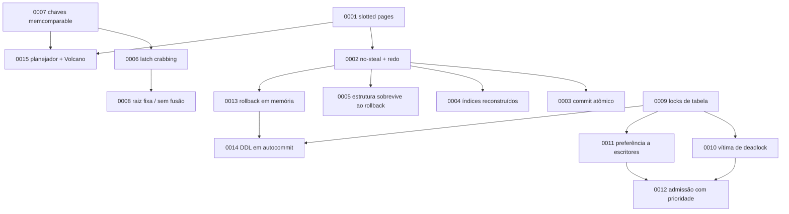

# Registros de Decisão de Arquitetura (ADRs)

Um ADR registra **uma** decisão de arquitetura: o problema, as alternativas que foram pesadas, a
escolha e, principalmente, **o que ela custa**. Usam o formato [MADR](https://adr.github.io/madr/)
(*Markdown Architectural Decision Records*), em português.

## Índice

| ADR | Título | Status |
|---|---|---|
| [0001](0001-paginas-4kb-slotted-pages.md) | Páginas de 4 KB com *slotted pages* para o heap | aceita |
| [0002](0002-no-steal-no-force-wal-redo.md) | *No-steal / no-force*, WAL de redo e checkpoint *sharp* | aceita |
| [0003](0003-commit-atomico-um-registro.md) | Commit atômico: um registro de WAL por transação, com CRC | aceita |
| [0004](0004-indices-reconstruidos-na-recuperacao.md) | Índices não são logados; reconstruídos na recuperação | aceita |
| [0005](0005-operacoes-estruturais-sobrevivem-ao-rollback.md) | Operações estruturais sobrevivem ao rollback | aceita |
| [0006](0006-btree-latch-crabbing.md) | B+tree com *latch crabbing* e guards `Arc` (`parking_lot`) | aceita |
| [0007](0007-chaves-memcomparable.md) | Chaves de índice *memcomparable* | aceita |
| [0008](0008-raiz-fixa-e-delete-sem-fusao.md) | Raiz fixa e `delete` sem fusão de nós | aceita (com dívida) |
| [0009](0009-locks-de-tabela-strict-2pl.md) | Locks de tabela com *strict two-phase locking* | aceita (com limitação) |
| [0010](0010-vitima-de-deadlock.md) | Vítima de deadlock por prioridade e custo | aceita |
| [0011](0011-preferencia-a-escritores.md) | Preferência a escritores no gerenciador de locks | aceita |
| [0012](0012-controle-de-admissao-com-prioridade.md) | Controle de admissão com prioridade, *aging* e cessão de vaga | aceita |
| [0013](0013-rollback-em-memoria-e-atomicidade-por-comando.md) | Rollback em memória e atomicidade por comando | aceita |
| [0014](0014-ddl-em-autocommit-e-publicacao-no-commit.md) | DDL só em autocommit, publicado no commit | aceita |
| [0015](0015-planejador-por-regras-e-executor-volcano.md) | Planejador por regras e executor *Volcano* | aceita |

## Como as decisões se relacionam



## Modelo para novos ADRs

Copie, numere sequencialmente e **nunca reescreva um ADR aceito**: se a decisão mudar, escreva outro e
marque o antigo como `substituída por ADR-NNNN`.

```markdown
# ADR-NNNN: Título no imperativo ou como afirmação curta

* **Status**: proposta | aceita | rejeitada | substituída por ADR-NNNN
* **Data**: AAAA-MM-DD
* **Módulos afetados**: `x`, `y`

## Contexto e declaração do problema
O que forçou a decisão? Que restrições valem?

## Fatores de decisão
* o que importa na escolha

## Opções consideradas
1. A
2. B

## Resultado da decisão
Escolhida: **A**, porque ...

### Consequências
* Bom: ...
* Ruim: ...

## Prós e contras das opções
### A ...
### B ...

## Validação
Como saber que a decisão se sustenta? (testes, métricas)

## Links
```
