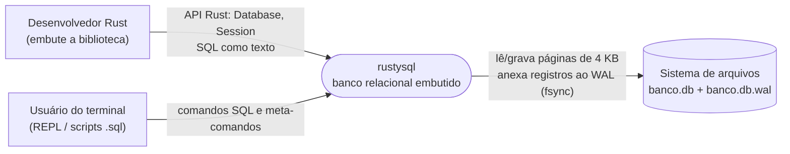
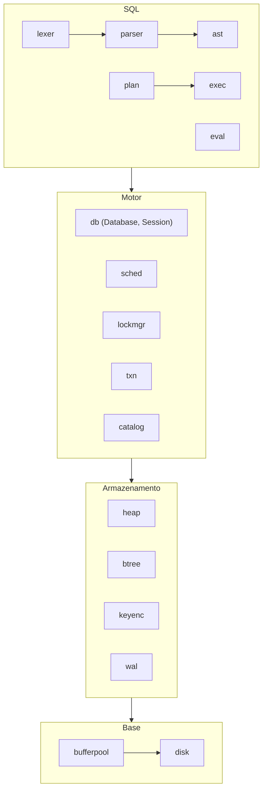
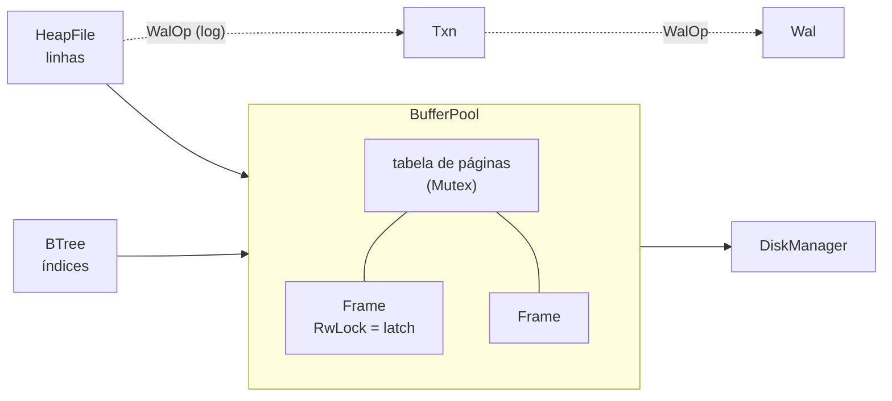
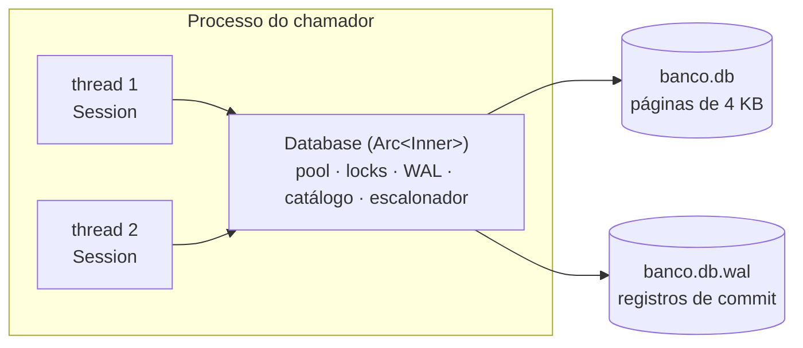
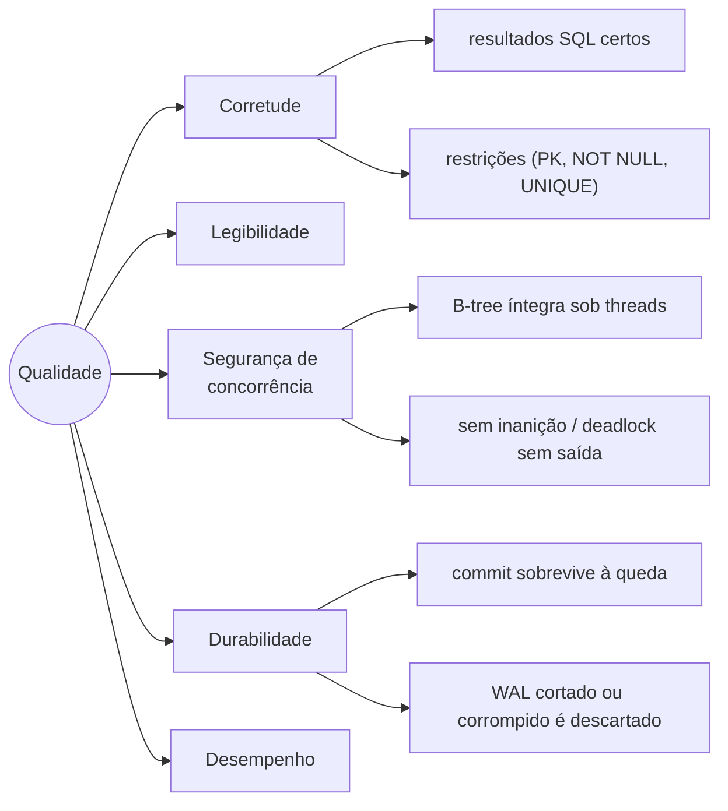

# Arquitetura do rustysql (arc42)

Documento de arquitetura no modelo [arc42](https://arc42.org) (versão 8). As seções 1 a 12 seguem a
numeração padrão do modelo. Diagramas adicionais estão em [`c4.md`](c4.md) e
[`runtime-scenarios.md`](runtime-scenarios.md).

---

## 1. Introdução e objetivos

### 1.1 Visão geral dos requisitos

O rustysql é um **banco de dados relacional embutido** (como o SQLite: uma biblioteca ligada ao
programa, sem servidor) cujo propósito é **didático**: cada mecanismo que um banco real precisa
(armazenamento em páginas, índices B+tree, log de transações, recuperação de falhas, controle de
concorrência, otimização de consultas) existe de forma completa, mas pequena o bastante para ser lida
inteira.

| ID | Requisito | Origem |
|---|---|---|
| R1 | Executar um subconjunto útil de SQL: DDL, DML, junções, agregações, subconjunto de expressões | objetivo do projeto |
| R2 | Persistir dados em disco e **sobreviver a quedas** sem perder transações commitadas | objetivo do projeto |
| R3 | Oferecer transações atômicas (`BEGIN`/`COMMIT`/`ROLLBACK`) e **isoladas** | objetivo do projeto |
| R4 | Aceitar **muitas threads** usando o banco ao mesmo tempo, mantendo as estruturas íntegras | pedido explícito (B-tree sob concorrência) |
| R5 | **Ordenar quem entra**: controlar admissão e prioridade das consultas, além de proteger o acesso | pedido explícito (gerenciador de prioridade) |
| R6 | Mostrar o plano de execução (`EXPLAIN`) e escolher índices sozinho | didático |
| R7 | Ser legível: um arquivo por conceito, comentários que explicam o *porquê* | didático |

### 1.2 Objetivos de qualidade

Em ordem de prioridade. Os cenários que os tornam mensuráveis estão na [seção 10](#10-requisitos-de-qualidade).

| # | Objetivo | Significado aqui |
|---|---|---|
| 1 | **Corretude** | nenhum resultado errado, nenhum dado perdido ou corrompido, em condições normais e de falha |
| 2 | **Legibilidade** | o código ensina; decisões não óbvias são explicadas onde acontecem |
| 3 | **Segurança de concorrência** | estruturas internas íntegras sob qualquer intercalação de threads |
| 4 | **Durabilidade** | transação commitada sobrevive à queda do processo |
| 5 | Desempenho | razoável (busca por índice em microssegundos); *não* é um objetivo competir com bancos de produção |

### 1.3 Partes interessadas

| Papel | Expectativa |
|---|---|
| Estudante / autor | entender cada camada de um banco; poder alterar uma e ver o efeito |
| Desenvolvedor Rust que embute a biblioteca | API pequena, `Send + Sync`, erros claros, transações que se comportam |
| Mantenedor | testes que pegam regressões (inclusive de concorrência), decisões registradas |

---

## 2. Restrições

| Tipo | Restrição | Consequência |
|---|---|---|
| Técnica | Rust (edição 2024), sem `unsafe` no código do projeto | a segurança de memória é verificada pelo compilador; guards "owned" vêm do `parking_lot` |
| Técnica | **uma** dependência de runtime (`parking_lot`) | tudo o mais (parser, B-tree, WAL, CRC) é implementado no projeto |
| Técnica | Processo único, arquivo único + log | sem rede, sem replicação, sem multiprocesso |
| Organizacional | Projeto de estudo mantido por uma pessoa | decisões favorecem simplicidade a generalidade |
| Convenção | Mensagens e documentação em português | erros e docs do usuário em pt-BR |
| Plataforma | Desenvolvido e testado no Windows; sem código específico de SO | `std::fs` e `fsync` via `sync_data` |

---

## 3. Contexto e escopo

### 3.1 Contexto de negócio

### 3.2 Contexto técnico

| Interface | Direção | Meio | Conteúdo |
|---|---|---|---|
| API Rust | entrada | chamadas de função (`Database::open`, `Session::execute`) | texto SQL; devolve `Vec<QueryResult>` |
| REPL / script | entrada | stdin ou arquivo `.sql` | texto SQL e meta-comandos (`.tables`, `.stats`...) |
| Arquivo de dados | saída | `<nome>.db` | páginas de 4 KB (formato em [`../reference/storage-formats.md`](../reference/storage-formats.md)) |
| Arquivo de log | saída | `<nome>.db.wal` | registros de commit com CRC |

**Escopo.** Dentro: parser, planejador, executor, transações, locks, escalonador, B-tree, heap, buffer
pool, WAL, recuperação. Fora: rede/servidor, usuários e permissões, replicação, criptografia,
compressão, `ALTER TABLE`, subconsultas.

---

## 4. Estratégia da solução

| Problema | Abordagem | Detalhe |
|---|---|---|
| Armazenar linhas de tamanho variável | páginas de 4 KB com *slotted pages* | [ADR-0001](../adr/0001-paginas-4kb-slotted-pages.md) |
| Sobreviver a quedas sem complicar o rollback | **no-steal / no-force** + WAL de **redo** + checkpoint *sharp* | [ADR-0002](../adr/0002-no-steal-no-force-wal-redo.md) |
| Commit atômico | um registro de WAL por transação, com CRC | [ADR-0003](../adr/0003-commit-atomico-um-registro.md) |
| Manter índices sem logá-los | reconstruir após recuperação | [ADR-0004](../adr/0004-indices-reconstruidos-na-recuperacao.md) |
| Rollback com páginas já alocadas | operações estruturais sobrevivem ao rollback | [ADR-0005](../adr/0005-operacoes-estruturais-sobrevivem-ao-rollback.md) |
| B-tree segura para várias threads | **latch crabbing** com guards `Arc` | [ADR-0006](../adr/0006-btree-latch-crabbing.md) |
| Índice independente de tipos | chaves em bytes comparáveis por `memcmp` | [ADR-0007](../adr/0007-chaves-memcomparable.md) |
| Isolamento entre transações | *strict 2PL* com locks de tabela | [ADR-0009](../adr/0009-locks-de-tabela-strict-2pl.md) |
| Deadlock sem esfomear escritores | grafo de espera + vítima por prioridade e custo | [ADR-0010](../adr/0010-vitima-de-deadlock.md), [ADR-0011](../adr/0011-preferencia-a-escritores.md) |
| Controlar **quem entra** | fila de admissão com prioridade e *aging* | [ADR-0012](../adr/0012-controle-de-admissao-com-prioridade.md) |
| Consultas eficientes | planejador por regras + executor *Volcano* | [ADR-0015](../adr/0015-planejador-por-regras-e-executor-volcano.md) |

**Princípio condutor.** *Três perguntas de concorrência, três mecanismos independentes*:

| Pergunta | Mecanismo | Módulo |
|---|---|---|
| **Quem entra?** (ordem de admissão) | fila de prioridade com aging | [`sched`](../modules/sched.md) |
| **Quem pode tocar nos dados?** (isolamento lógico) | locks de tabela S/X, 2PL | [`lockmgr`](../modules/lockmgr.md) |
| **A estrutura continua íntegra?** (isolamento físico) | latches de página, crabbing | [`bufferpool`](../modules/bufferpool.md), [`btree`](../modules/btree.md) |

---

## 5. Visão de blocos de construção

### 5.1 Nível 1: camadas

Cada camada só usa a de baixo. O grafo completo de dependências, extraído do código, está em
[`../modules/README.md`](../modules/README.md#grafo-de-dependências).

### 5.2 Nível 2: módulos

| Camada | Módulo | Responsabilidade | Documento |
|---|---|---|---|
| Base | `disk` | ler/gravar páginas inteiras num arquivo | [disk](../modules/disk.md) |
| Base | `bufferpool` | cache de páginas, latches, pin, despejo, *no-steal* | [bufferpool](../modules/bufferpool.md) |
| Armazenamento | `wal` | log de redo; commit atômico; CRC | [wal](../modules/wal.md) |
| Armazenamento | `heap` | registros em *slotted pages*; compactação; `RowId` | [heap](../modules/heap.md) |
| Armazenamento | `btree` | B+tree concorrente; busca, inserção, remoção, varredura, verificação | [btree](../modules/btree.md) |
| Armazenamento | `keyenc` | codificação de chaves comparáveis por `memcmp` | [keyenc](../modules/keyenc.md) |
| Motor | `lockmgr` | locks de tabela, deadlock, vítima | [lockmgr](../modules/lockmgr.md) |
| Motor | `sched` | admissão por prioridade, aging, cessão de vaga | [sched](../modules/sched.md) |
| Motor | `txn` | estado da transação, undo, marcas | [txn](../modules/txn.md) |
| Motor | `catalog` | tabelas e índices em memória | [catalog](../modules/catalog.md) |
| Motor | `db` | `Database`, `Session`, recuperação, checkpoint, DDL/DML | [db](../modules/db.md) |
| Dados | `value`, `schema` | valores, tipos, linhas, esquema | [value](../modules/value.md), [schema](../modules/schema.md) |
| SQL | `lexer`, `parser`, `ast` | texto → árvore sintática | [lexer](../modules/lexer.md), [parser](../modules/parser.md), [ast](../modules/ast.md) |
| SQL | `eval` | expressões, lógica de três valores | [eval](../modules/eval.md) |
| SQL | `plan`, `exec` | otimização por regras; operadores *Volcano* | [plan](../modules/plan.md), [exec](../modules/exec.md) |
| Transversal | `error` | tipo de erro único | [error](../modules/error.md) |
| Interface | `main` | REPL e modo script | [main](../modules/main.md) |

### 5.3 Nível 3: o coração do armazenamento

* O `Txn` acumula as operações de heap; no commit elas viram **um** registro do `Wal`.
* O `BufferPool` nunca grava uma página suja por conta própria (*no-steal*): quem grava é o checkpoint.
* `heap` e `btree` só enxergam páginas; não sabem o que é uma tabela (isso é o `catalog`).

---

## 6. Visão de execução

Os fluxos principais, com diagramas de sequência, estão em
[`runtime-scenarios.md`](runtime-scenarios.md):

| # | Cenário |
|---|---|
| 1 | Um `SELECT` ponta a ponta (da sessão ao resultado) |
| 2 | Commit de uma transação |
| 3 | Rollback de um comando e de uma transação |
| 4 | Abertura do banco após uma queda (recuperação) |
| 5 | Checkpoint |
| 6 | Divisão de um nó da B-tree com *latch crabbing* |
| 7 | Deadlock e escolha da vítima |
| 8 | Admissão por prioridade, com aging e cessão de vaga |

---

## 7. Visão de implantação

Não há implantação no sentido de servidores: o banco é uma biblioteca que roda **dentro do processo**
do chamador.

| Artefato | Conteúdo | Quando é escrito |
|---|---|---|
| `<nome>.db` | página 0 = cabeçalho; página 1 = raiz do catálogo; demais = heaps e B-trees | **só** em checkpoint |
| `<nome>.db.wal` | uma sequência de registros `[len][crc][payload]`, um por commit | a cada commit (`fsync` se `sync_commits`) |

Um banco "limpo" (fechado normalmente) tem o `.wal` com 0 bytes. Detalhes de formato em
[`../reference/storage-formats.md`](../reference/storage-formats.md).

---

## 8. Conceitos transversais

### 8.1 Concorrência (três camadas)

Ver o princípio na [seção 4](#4-estratégia-da-solução). Regras que valem em todo o código:

1. **Ordem de aquisição**: latches de página sempre de cima para baixo na árvore e da esquerda para a
   direita nas folhas; locks de tabela em ordem de id dentro de um comando; o gerenciador de locks
   nunca chama o escalonador *esperando* (só o libera), e o escalonador nunca chama o gerenciador
   de locks. Isso exclui ciclos entre as três camadas.
2. **Pin por `Arc`**: uma página só é despejada com `Arc::strong_count == 1`.
3. **Mutexes curtos**: nenhum mutex interno é segurado enquanto se espera por um latch de página.
4. **Portão de checkpoint** (`RwLock<()>`): toda transação segura o lado de leitura; o checkpoint pega
   o de escrita. Garante que não há transação ativa durante a gravação das páginas.

### 8.2 Durabilidade e recuperação

*No-steal / no-force* com WAL de redo: as páginas só vão ao disco no checkpoint; o commit grava (e
`fsync`a) o log. A abertura refaz o log e reconstrói os índices. Ver
[ADR-0002](../adr/0002-no-steal-no-force-wal-redo.md) a [ADR-0005](../adr/0005-operacoes-estruturais-sobrevivem-ao-rollback.md).

### 8.3 Tratamento de erros

Um único `enum Error` ([`error`](../modules/error.md)). Três variantes são **transitórias**
(`Deadlock`, `LockTimeout`, `QueueTimeout`): o motor já desfez a transação, e o chamador deve
repetir com recuo exponencial. As demais são definitivas para aquele comando. Dentro de uma
transação explícita, um erro comum desfaz **só o comando** (atomicidade por comando); as transitórias
abortam a transação inteira. Catálogo completo em [`../reference/errors.md`](../reference/errors.md).

### 8.4 Modelo de dados e `NULL`

Quatro tipos (`INT`, `FLOAT`, `TEXT`, `BOOL`) mais `NULL`, com lógica de três valores nas expressões.
Uma linha é um `Vec<Value>`; no disco, uma sequência de valores com *tag*.

### 8.5 Identificadores

Nomes de tabelas, colunas, índices e aliases são normalizados para minúsculas pelo parser; palavras-chave
não diferenciam caixa. Strings preservam o conteúdo.

### 8.6 Testabilidade

Quase tudo é `pub` para permitir testes de integração por camada (B-tree sem SQL, escalonador sem banco).
`Database::simulate_crash` simula uma queda sem checkpoint final. `BTree::verify` confere todos os
invariantes da árvore. Estratégia completa em [`../development/testing.md`](../development/testing.md).

### 8.7 Documentação de código

`#![warn(missing_docs)]` no crate: todo item público tem rustdoc. Exemplos em rustdoc são
**executados** como testes (`cargo test --doc`).

---

## 9. Decisões de arquitetura

Registradas em formato MADR em [`../adr/`](../adr/README.md):

| ADR | Decisão | Status |
|---|---|---|
| [0001](../adr/0001-paginas-4kb-slotted-pages.md) | Páginas de 4 KB com slotted pages | aceita |
| [0002](../adr/0002-no-steal-no-force-wal-redo.md) | No-steal/no-force, WAL de redo, checkpoint sharp | aceita |
| [0003](../adr/0003-commit-atomico-um-registro.md) | Commit atômico: um registro de WAL com CRC | aceita |
| [0004](../adr/0004-indices-reconstruidos-na-recuperacao.md) | Índices não são logados; reconstruídos na recuperação | aceita |
| [0005](../adr/0005-operacoes-estruturais-sobrevivem-ao-rollback.md) | Operações estruturais sobrevivem ao rollback | aceita |
| [0006](../adr/0006-btree-latch-crabbing.md) | B+tree com latch crabbing e guards `Arc` | aceita |
| [0007](../adr/0007-chaves-memcomparable.md) | Chaves *memcomparable* | aceita |
| [0008](../adr/0008-raiz-fixa-e-delete-sem-fusao.md) | Raiz fixa e `delete` sem fusão de nós | aceita (com dívida) |
| [0009](../adr/0009-locks-de-tabela-strict-2pl.md) | Locks de tabela, strict 2PL | aceita (com limitação) |
| [0010](../adr/0010-vitima-de-deadlock.md) | Vítima de deadlock por prioridade e custo | aceita |
| [0011](../adr/0011-preferencia-a-escritores.md) | Preferência a escritores nos locks | aceita |
| [0012](../adr/0012-controle-de-admissao-com-prioridade.md) | Controle de admissão com prioridade, aging e cessão de vaga | aceita |
| [0013](../adr/0013-rollback-em-memoria-e-atomicidade-por-comando.md) | Rollback em memória e atomicidade por comando | aceita |
| [0014](../adr/0014-ddl-em-autocommit-e-publicacao-no-commit.md) | DDL só em autocommit, publicado no commit | aceita |
| [0015](../adr/0015-planejador-por-regras-e-executor-volcano.md) | Planejador por regras e executor Volcano | aceita |

---

## 10. Requisitos de qualidade

### 10.1 Árvore de qualidade

### 10.2 Cenários de qualidade

| ID | Qualidade | Cenário | Medida | Verificado por |
|---|---|---|---|---|
| Q1 | Concorrência | 8 escritores + 4 leitores inserem/buscam 22 mil chaves na mesma B-tree | árvore passa em `verify()`; nenhuma chave perdida ou repetida | `btree::concurrent_writers_and_readers_preserve_integrity` |
| Q2 | Concorrência | escritores com chaves de 150 bytes forçam uma árvore de 3 níveis | idem | `btree::concurrent_inserts_and_deletes_with_deep_tree` |
| Q3 | Isolamento | 6 threads transferem dinheiro entre duas tabelas (ordens de lock opostas) enquanto 2 auditores somam | soma sempre 2000; nenhum estado parcial visível | `txn::concurrent_transfers_conserve_money_and_never_expose_partial_state` |
| Q4 | Durabilidade | queda logo depois de commits | dados commitados presentes; índices funcionando | `recovery::committed_work_survives_a_crash_including_indexes` |
| Q5 | Durabilidade | WAL cortado no meio do último registro | só o último commit se perde | `recovery::a_torn_wal_tail_drops_only_the_unfinished_commit` |
| Q6 | Durabilidade | um byte do último registro é alterado | CRC detecta; registro descartado | `recovery::a_corrupted_wal_record_is_detected_by_the_checksum` |
| Q7 | Atomicidade | queda no meio de uma transação aberta | nada dela aparece | `recovery::an_uncommitted_transaction_is_lost_on_crash` |
| Q8 | Justiça | `LOW` espera mais que o *aging* | passa à frente de um `HIGH` recém-chegado | `sched::aging_lets_a_long_waiting_low_overtake_a_fresh_high` |
| Q9 | Justiça | deadlock entre `HIGH` e `LOW` | a vítima é sempre a `LOW` | `sched::deadlock_victim_is_the_lowest_priority_not_the_last_to_ask` |
| Q10 | Desempenho | busca por chave primária em 20 mil linhas | ~10² µs (vs. ~10⁴ µs sem índice) | `demo.sql` (medido; não há teste de desempenho automatizado) |

---

## 11. Riscos e dívida técnica

| ID | Item | Impacto | Mitigação / plano |
|---|---|---|---|
| D1 | Locks só por **tabela** | escritores e leitores da mesma tabela se excluem; baixa concorrência | locks de linha + intenção, ou MVCC (grande) |
| D2 | **No-steal**: transação precisa caber no pool | `INSERT` enorme falha com "buffer pool cheio" | *steal* exigiria log de undo em disco (ARIES) |
| D3 | `delete` da B-tree não funde nós | árvore pode ficar esparsa após muitas remoções | fusão/redistribuição de nós irmãos |
| D4 | `DROP TABLE` não recicla páginas | arquivo só cresce | lista de páginas livres |
| D5 | Índices não logados | recuperação custa O(dados) | logar operações de índice ou fazer checkpoint com mais frequência |
| D6 | O `RwLock` do portão de checkpoint espera transações explícitas ociosas | uma sessão que esquece o `COMMIT` bloqueia checkpoints | timeout/abort de transações ociosas |
| D7 | Um índice cobre uma coluna; uma só `PRIMARY KEY` | modelagem limitada | índices compostos (ordem lexicográfica das chaves já suporta) |
| D8 | Sem estatísticas no planejador | escolhe índice por regra, não por custo | histogramas e cardinalidades |
| D9 | `fsync` por commit, sem *group commit* | commits sequenciais limitados pelo disco | agrupar commits concorrentes num só `fsync` |
| R1 | Torn page: uma página de 4 KB pode ser gravada pela metade numa queda durante o checkpoint | corrupção se o SO não garantir atomicidade de 4 KB | redo idempotente mitiga a maioria dos casos; *double-write buffer* resolveria |

---

## 12. Glossário

Ver [`../development/glossary.md`](../development/glossary.md).
