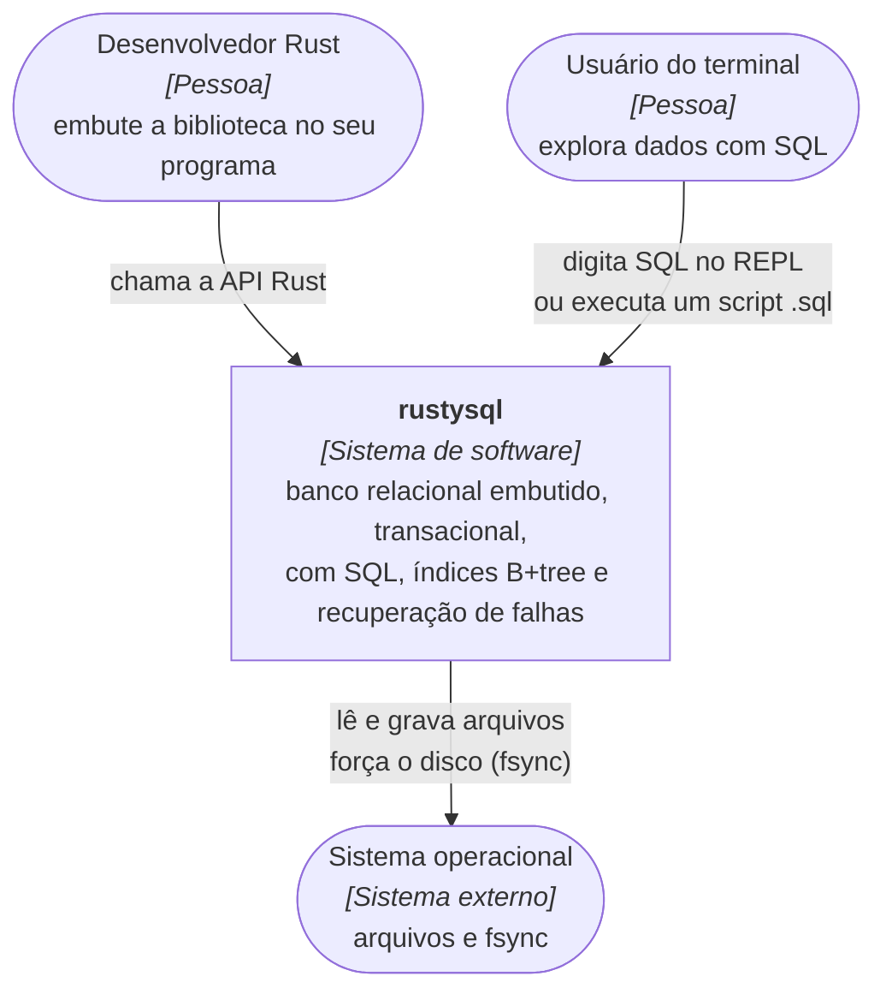
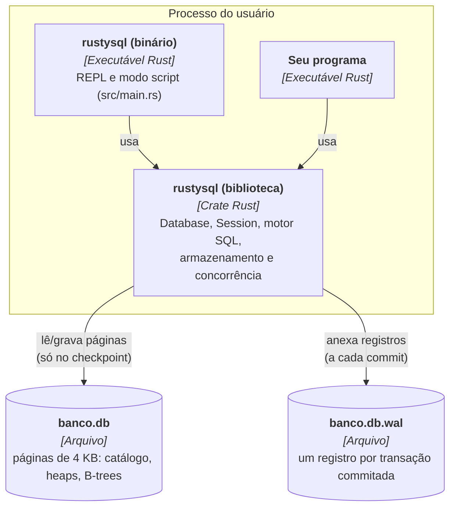
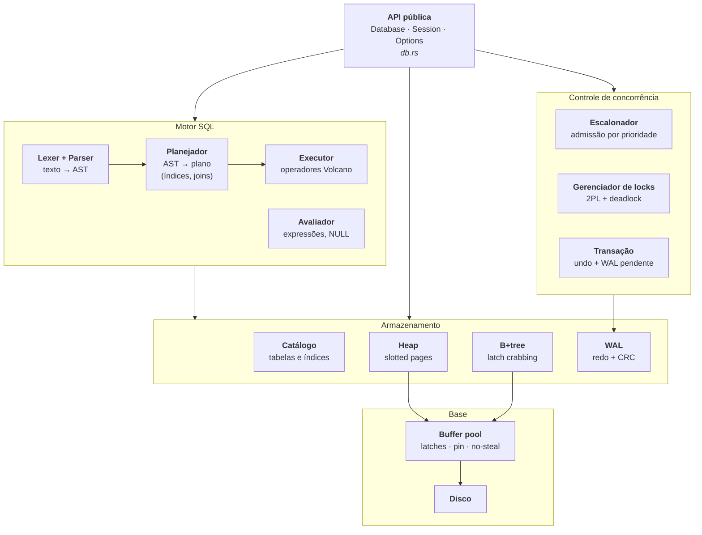
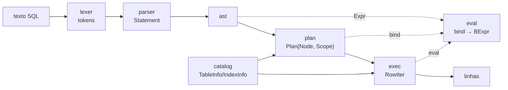
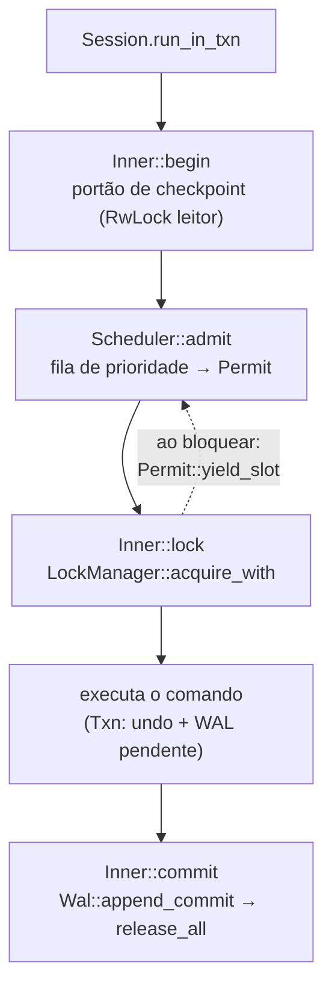
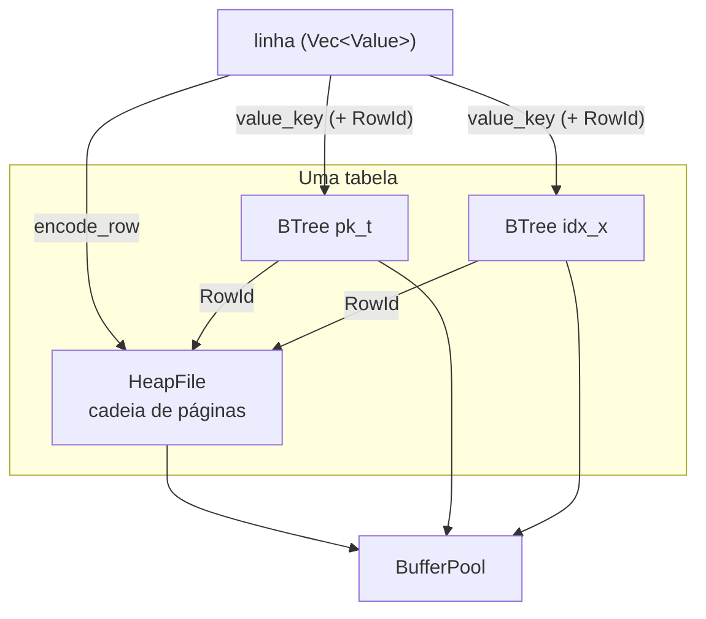

# Diagramas C4

O [modelo C4](https://c4model.com) descreve um sistema em quatro níveis de zoom: **Contexto**, **Contêineres**,
**Componentes** e **Código**. Os diagramas abaixo usam `flowchart` do Mermaid (a notação C4 nativa do
Mermaid ainda é experimental e não renderiza em todo lugar). Convenção: retângulo = componente
próprio; cilindro = armazenamento; elipse = sistema externo ou pessoa.

## Nível 1: Contexto do sistema

Quem usa o rustysql e com o que ele conversa.

## Nível 2: Contêineres

Num banco embutido, "contêiner" é uma unidade executável ou de dados distinta.

| Contêiner | Tecnologia | Responsabilidade |
|---|---|---|
| Biblioteca | Rust, `parking_lot` | todo o banco |
| Binário | Rust | REPL interativo e execução de scripts com tempos por comando |
| `banco.db` | arquivo de páginas | estado commitado no último checkpoint |
| `banco.db.wal` | arquivo de log | commits desde o último checkpoint |

## Nível 3: Componentes da biblioteca

### 3a. Visão geral

### 3b. Dentro do componente "Motor SQL"

### 3c. Dentro do componente "Controle de concorrência"

### 3d. Dentro do componente "Armazenamento"

## Nível 4: Código

O nível de código **é** o código: cada módulo tem a sua página em [`../modules/`](../modules/README.md)
e a API completa em rustdoc (`cargo doc --no-deps --open`). As estruturas de dados centrais:

| Estrutura | Módulo | Papel |
|---|---|---|
| `Frame` / `PageRef` / `PageReadGuard` / `PageWriteGuard` | `bufferpool` | página + pin + latch |
| `RowId { page, slot }` | `heap` | endereço físico de uma linha |
| `Node { Leaf, Internal }` | `btree` (privado) | nó da B+tree |
| `WalOp`, `Batch` | `wal` | operação de redo; registro de commit |
| `Txn`, `Undo`, `Mark` | `txn` | transação em andamento |
| `Plan { node, scope }`, `Node` | `plan` | plano de execução |
| `Permit`, `Entry` | `sched` | vaga de execução; item da fila de prioridade |
