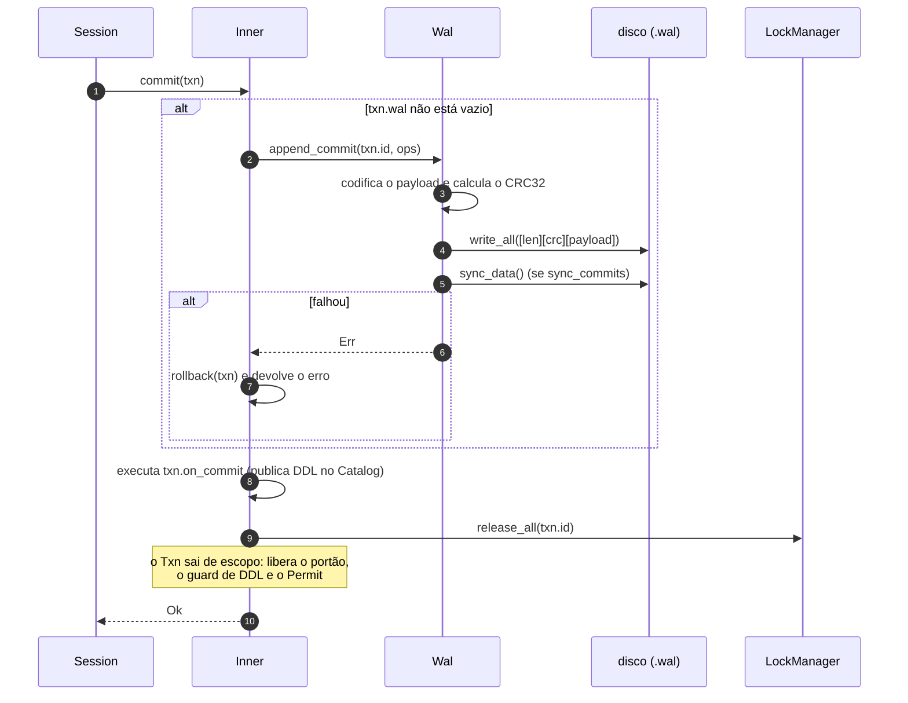
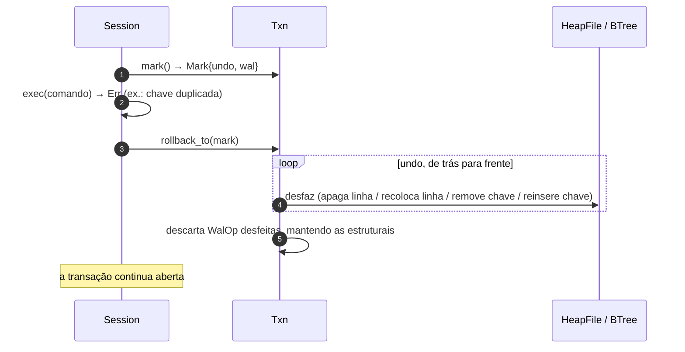
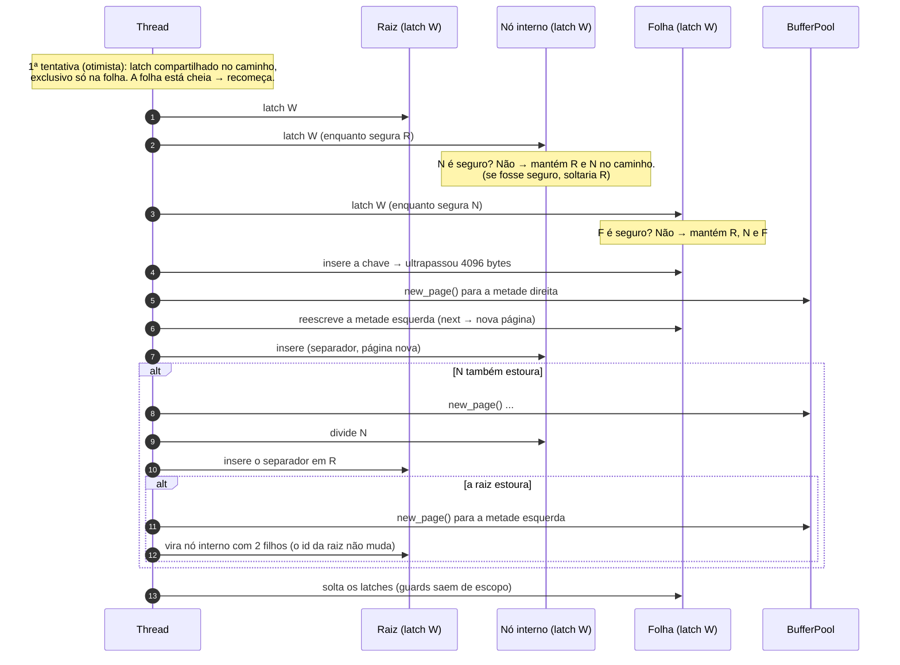
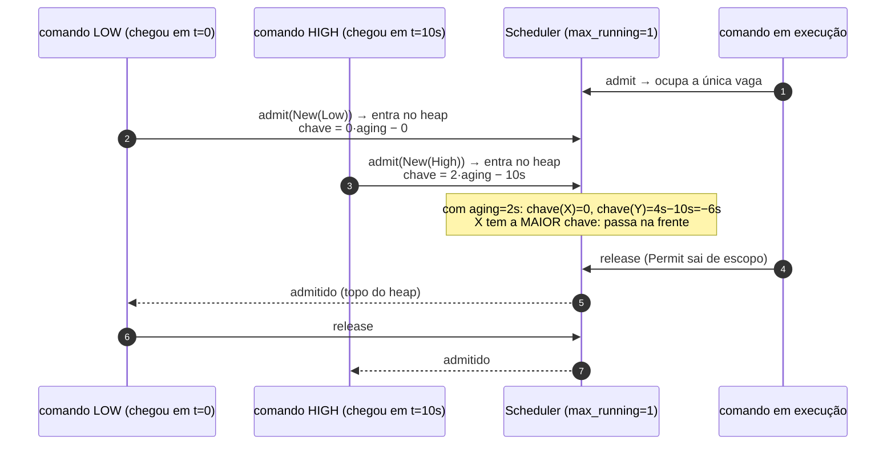

# Cenários de execução

Diagramas de sequência dos fluxos principais, com os nomes reais das funções. Cada cenário indica o
código envolvido e o que o teste automatizado garante.

Convenções: `──▶` chamada; `- - ▶` retorno ou efeito assíncrono; blocos `alt` mostram variações.

---

## 1. Um `SELECT`, ponta a ponta

`Session::execute` → `parse` → `run_in_txn` → `Inner::select`.

```mermaid
sequenceDiagram
    autonumber
    participant C as Chamador
    participant S as Session
    participant I as Inner (db.rs)
    participant Q as Scheduler
    participant L as LockManager
    participant P as plan_select
    participant E as exec::execute
    participant B as BufferPool

    C->>S: execute("SELECT ...")
    S->>S: parse(sql) → Vec<Statement>
    S->>I: begin(explicit=false, priority)
    Note over I: pode fazer checkpoint se há muitas páginas sujas;<br/>pega o portão (leitor) e cria o Txn
    S->>Q: admit(New(priority))
    Q-->>S: Permit (espera na fila se max_running foi atingido)
    S->>I: exec(txn, Select)
    I->>I: select_tables: resolve as tabelas no Catalog
    loop tabelas, em ordem de id
        I->>L: lock(txn, tabela, Shared)
    end
    I->>P: plan_select(stmt, tabelas)
    P-->>I: Plan (escolheu SeqScan/IndexScan/joins)
    I->>E: execute(&plan) → RowIter
    loop até o fim
        E->>B: fetch(página) + latch de leitura
        B-->>E: linhas
    end
    E-->>I: Vec<Row>
    I-->>S: QueryResult::Rows
    S->>I: commit(txn) (sem WAL: só leitura)
    Note over I: release_all(locks), solta o Permit e o portão
    S-->>C: Vec<QueryResult>
```

**Pontos de atenção**

* O `begin` vem **antes** da fila de admissão: ele pode esperar um checkpoint, e quem espera na fila
  não pode estar segurando uma vaga de que o checkpoint dependa.
* Os locks só caem no `commit` (2PL estrito), mesmo num `SELECT` em autocommit.
* Teste: `sql::joins_choose_the_right_algorithm_and_compute_correctly`,
  `txn::readers_share_the_lock`.

---

## 2. Commit de uma transação



**Garantia** (`recovery::committed_work_survives_a_crash_including_indexes`): depois que o `commit`
retorna `Ok`, a transação sobrevive a uma queda. Antes de o registro estar inteiro no disco, a
transação não existe (`recovery::a_torn_wal_tail_drops_only_the_unfinished_commit`).

---

## 3. Rollback

### 3a. Desfazer só o comando que falhou (dentro de uma transação explícita)



### 3b. Desfazer a transação inteira

Igual a 3a com `Mark::start()`. Depois, o que sobrou em `txn.wal` (só operações
**estruturais**: páginas novas e encadeamento) é gravado no WAL como um registro próprio **antes** de
soltar os locks, porque a próxima transação vai escrever naquelas páginas
([ADR-0005](../adr/0005-operacoes-estruturais-sobrevivem-ao-rollback.md)).

Testes: `txn::rollback_and_commit`, `txn::a_failing_statement_does_not_abort_the_transaction`,
`recovery::pages_allocated_by_a_rolled_back_transaction_still_work_after_recovery`.

---

## 4. Abertura do banco e recuperação

`Database::open_with`.

```mermaid
sequenceDiagram
    autonumber
    participant O as open_with
    participant P as BufferPool
    participant W as Wal
    participant H as heap::apply_op
    participant I as Inner
    participant C as Catalog

    O->>P: open(arquivo .db)
    O->>W: open(arquivo .wal)
    W->>W: lê registros; para no 1º com tamanho/CRC inválido
    W->>W: trunca o arquivo nesse ponto
    W-->>O: (Wal, Vec<Batch>)
    alt banco novo (só a página 0)
        O->>P: cria a página 1 (raiz do catálogo)
    else banco existente
        loop cada Batch, em ordem
            O->>H: apply_op(cada WalOp)
            Note over H: HeapFormat, HeapLink, HeapInsert, HeapDelete<br/>todas idempotentes
        end
    end
    O->>I: load_catalog() — lê o heap da página 1
    I->>C: publica TableInfo / IndexInfo
    alt houve registros no WAL
        O->>I: rebuild_indexes(): zera cada árvore e reinsere tudo do heap
    end
    alt banco novo ou recuperou algo
        O->>I: checkpoint(): grava as páginas e esvazia o WAL
    end
    O-->>O: Database pronto
```

**Idempotência.** Cada operação de redo pode ser reaplicada sobre uma página que já a contém:
`HeapInsert` coloca o conteúdo *exatamente* no slot (e não faz nada se já está lá), `HeapDelete` só
apaga se existe. Por isso uma queda **durante** a recuperação ou o checkpoint também é recuperável
(`recovery::replaying_the_log_twice_gives_the_same_result`).

---

## 5. Checkpoint

```mermaid
sequenceDiagram
    autonumber
    participant X as quem chamou (CHECKPOINT ou begin())
    participant G as portão (RwLock)
    participant P as BufferPool
    participant W as Wal

    X->>G: write() — espera todas as transações ativas terminarem<br/>e bloqueia as novas
    G-->>X: exclusivo
    X->>P: flush_all()
    loop cada página suja
        P->>P: dirty ← false; pega latch de leitura
        P->>P: DiskManager::write_page
    end
    P->>P: sync_data()
    X->>W: reset() — trunca o log para 0 e sincroniza
    X->>G: solta o portão
```

* **Quando roda**: `CHECKPOINT` explícito; no `begin()` quando `páginas sujas > checkpoint_ratio ×
  capacidade`; ao abrir um banco novo ou recuperado; ao descartar o último handle (`Drop`).
* **Por que "sharp"**: com o portão exclusivo não existe transação ativa, então todas as páginas
  em memória representam estados commitados.
* **Ordem importa**: o log só é esvaziado **depois** das páginas estarem no disco (`fsync`).
  Se a queda ocorrer entre as duas etapas, o log é reaplicado sobre páginas já atualizadas
  (idempotente).
* Testes: `recovery::checkpoint_empties_the_wal_and_later_commits_replay_on_top_of_it`,
  `recovery::small_buffer_pool_evicts_clean_pages_and_checkpoints_automatically`.

---

## 6. Divisão de um nó da B-tree (latch crabbing)

Inserção que força um *split*, com o caminho pessimista (`BTree::insert_pessimistic`). Os latches são
exclusivos; "seguro" significa que o nó absorve mais uma entrada sem dividir.



**Por que não há deadlock de latch**: todo mundo trava de cima para baixo, e as varreduras de
intervalo seguram um latch por vez (seguindo `next` da esquerda para a direita).
**Por que a busca não vê um nó "pela metade"**: o leitor só solta o latch do pai depois de ter o do
filho, e o escritor segura o do pai até terminar de reescrever o filho.

Testes: `btree::concurrent_writers_and_readers_preserve_integrity` (com mutação: remover o
acoplamento faz o teste falhar), `btree::concurrent_inserts_and_deletes_with_deep_tree`.

---

## 7. Deadlock e escolha da vítima

```mermaid
sequenceDiagram
    autonumber
    participant A as Txn A (HIGH)
    participant B as Txn B (LOW)
    participant L as LockManager

    A->>L: acquire(tabela 1, X)
    L-->>A: concedido
    B->>L: acquire(tabela 2, X)
    L-->>B: concedido
    B->>L: acquire(tabela 1, X)
    Note over L: bloqueia: grafo B → A
    A->>L: acquire(tabela 2, X)
    Note over L: A fecharia o ciclo A → B → A.<br/>find_cycle devolve {A, B}.<br/>pick_victim: menor prioridade → B
    L->>L: victims ← {B}; notify_all
    L-->>B: (acorda) Err(Deadlock)
    Note over B: Session faz rollback total e solta os locks
    L-->>A: concedido (B liberou a tabela 2)
```

A vítima é escolhida **entre os membros do ciclo**, não por quem chegou por último:
1. menor prioridade (`Priority`) → 2. menos locks exclusivos (menos trabalho a perder) → 3. o mais novo.
Se a vítima é o próprio requisitante, a chamada retorna `Err(Deadlock)` na hora.

Testes: `txn::deadlock_is_detected_and_one_victim_is_chosen`,
`sched::deadlock_victim_is_the_lowest_priority_not_the_last_to_ask`,
`sched::with_equal_priority_the_victim_is_the_one_with_less_work_to_lose`.

---

## 8. Admissão por prioridade (aging e cessão de vaga)



**Cessão de vaga ao bloquear** (`Inner::lock`):

```mermaid
sequenceDiagram
    autonumber
    participant R as Leitor (com Permit)
    participant L as LockManager
    participant Q as Scheduler
    participant W as Escritor (transação aberta)

    W->>L: já segura X na tabela
    R->>L: acquire_with(S, on_block)
    L->>Q: on_block → Permit::yield_slot() (a vaga volta)
    Note over R: dorme na Condvar do LockManager
    W->>Q: próximo comando entra (a vaga estava livre)
    W->>L: commit → release_all
    L-->>R: acorda; lock concedido
    R->>Q: Permit::resume() → admit(Resume) com prioridade máxima
```

Sem a cessão, com `max_running = 1`, o leitor bloqueado ocuparia a única vaga e o escritor nunca
entraria para terminar. Teste: `sched::a_statement_blocked_on_a_lock_gives_its_slot_back`.
