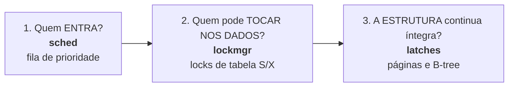

# Guia: transações, isolamento e concorrência

Como várias threads e transações convivem no rustysql, o que cada garantia significa na prática e como
escrever código que se comporta bem sob concorrência.

## O modelo mental: três perguntas



| Pergunta | Mecanismo | O que você controla |
|---|---|---|
| Quantos comandos rodam ao mesmo tempo, e em que ordem entram? | gerenciador de prioridade | `SET PRIORITY`, `max_running` |
| Duas transações podem mexer na mesma tabela? | locks de tabela (2PL) | a ordem em que você toca as tabelas, o tamanho das transações |
| A B-tree fica consistente com mil threads? | latches de página | nada: é por construção |

A terceira camada é transparente: nenhum código seu pode corromper a árvore. As duas primeiras
**afetam o seu programa** e são o assunto deste guia.

## Transações

### Autocommit e `BEGIN`

```sql
UPDATE conta SET saldo = saldo - 10 WHERE id = 1;     -- transação própria (autocommit)

BEGIN;                                                 -- agora várias ações são uma só
UPDATE conta SET saldo = saldo - 10 WHERE id = 1;
UPDATE conta SET saldo = saldo + 10 WHERE id = 2;
COMMIT;                                                -- ou ROLLBACK
```

### Garantias (ACID)

| Propriedade | Como o rustysql a dá |
|---|---|
| **Atomicidade** | o rollback desfaz tudo em memória; o WAL só tem transações **completas** |
| **Consistência** | `PRIMARY KEY`, `NOT NULL` e índices `UNIQUE` são checados a cada comando |
| **Isolamento** | **serializável por tabela** (veja abaixo) |
| **Durabilidade** | `COMMIT` só retorna depois do `fsync` do WAL (com `sync_commits`, o padrão) |

### O que acontece quando um comando falha

| Situação | Efeito |
|---|---|
| comando comum falha (chave duplicada, tipo errado...) | **só o comando** é desfeito; a transação continua |
| `Deadlock` ou `LockTimeout` | a transação **inteira** é desfeita; os locks são soltos |
| a `Session` é descartada com a transação aberta | rollback automático |
| o processo cai | a transação aberta **desaparece** (nunca chegou ao WAL) |

## Isolamento: locks de tabela

* `SELECT` pega um lock **compartilhado** (S) em cada tabela do `FROM`.
* `INSERT`, `UPDATE`, `DELETE` e DDL pegam um lock **exclusivo** (X) na tabela.
* Os locks só são soltos no **fim da transação** (*strict two-phase locking*).

| Quem tem → quem pede | S | X |
|---|:---:|:---:|
| **S** | ✓ compartilha | espera |
| **X** | espera | espera |

Consequências práticas:

1. **Sem leituras sujas**: você nunca vê dados não commitados de outra transação; o leitor **espera**.
2. **Leituras repetíveis** dentro de uma transação: o lock S segura a tabela até o fim.
3. **Sem anomalias de leitura**: o cenário clássico "transferência com auditor" (somar dois saldos enquanto
   alguém transfere) **sempre** vê a soma certa
   (`txn::concurrent_transfers_conserve_money_and_never_expose_partial_state`).
4. **Escritores da mesma tabela se serializam**. Escritores de **tabelas diferentes** rodam em paralelo.
5. **Leitor e escritor da mesma tabela se excluem**: um escritor lento atrasa os leitores dessa tabela.

> **Dica de desempenho**: mantenha as transações **curtas** e **não deixe uma transação aberta
> esperando entrada do usuário**: ela segura locks (e trava os checkpoints!).

## Deadlocks

Um deadlock é um ciclo de espera:

```
Transação A:  UPDATE t1 ...   (pega X em t1)        Transação B:  UPDATE t2 ...   (pega X em t2)
Transação A:  UPDATE t2 ...   (espera B)             Transação B:  UPDATE t1 ...   (espera A)
```

O banco **detecta** o ciclo na hora (não espera o timeout) e **aborta uma das transações**: ela recebe
`Error::Deadlock` e já foi desfeita. A vítima é a de **menor prioridade**; empatando, a que fez **menos
trabalho** (menos locks exclusivos); empatando, a **mais nova**.

### Como evitar

1. **Toque as tabelas sempre na mesma ordem** em todas as transações (a regra de ouro). Dentro de um
   único `SELECT`, o banco já pega os locks em ordem de id.
2. Mantenha as transações pequenas.
3. Se não dá para evitar, **repita** (próxima seção).

## Repetindo transações

`Deadlock`, `LockTimeout` e `QueueTimeout` são erros **transitórios**: a transação já foi desfeita e
tentar de novo costuma funcionar. Use **recuo exponencial com jitter**, senão as duas transações
colidem de novo na hora:

```rust
use rustysql::{Database, Error};
use std::{thread, time::Duration};

fn transferir(db: &Database, de: i64, para: i64, valor: i64) -> Result<(), Error> {
    let mut s = db.session();
    let mut tentativa = 0u32;
    loop {
        let r = (|| {
            s.execute("BEGIN")?;
            s.execute(&format!("UPDATE conta SET saldo = saldo - {valor} WHERE id = {de}"))?;
            s.execute(&format!("UPDATE conta SET saldo = saldo + {valor} WHERE id = {para}"))?;
            s.execute("COMMIT")
        })();
        match r {
            Ok(_) => return Ok(()),
            Err(Error::Deadlock | Error::LockTimeout) if tentativa < 20 => {
                tentativa += 1;
                // 100µs, 200µs, 400µs... até ~25 ms, com um jitter derivado da tentativa
                let teto = 100u64 << tentativa.min(8);
                thread::sleep(Duration::from_micros(teto / 2 + (tentativa as u64 * 7919) % (teto / 2 + 1)));
            }
            Err(e) => return Err(e),       // erro definitivo (ex.: chave duplicada)
        }
    }
}
```

Um erro **não** transitório (`Exec`, `Parse`...) **não** deve ser repetido: dará o mesmo resultado.
Repare que o `COMMIT` também pode falhar; **toda a transação** é o que se repete.

> Este é o padrão usado pelo teste `txn::concurrent_transfers_conserve_money_and_never_expose_partial_state`
> (6 threads, ordens de lock opostas, 2 auditores).

## Prioridades

`SET PRIORITY LOW|NORMAL|HIGH` define a prioridade de **todos os comandos futuros da sessão**:

```sql
SET PRIORITY HIGH;       -- ex.: a sessão do painel que o usuário está olhando
SET PRIORITY LOW;        -- ex.: relatório noturno, exportação em segundo plano
```

A prioridade tem **três efeitos**:

| Efeito | Detalhe |
|---|---|
| **Ordem de entrada** | com a fila cheia (`max_running` comandos já rodando), `HIGH` entra antes de `NORMAL`, que entra antes de `LOW`; dentro do mesmo nível, ordem de chegada |
| **Anti-inanição (aging)** | quem espera muito ganha prioridade: com o padrão (`aging_step` = 2 s), um `LOW` que esperou 4 s passa à frente de um `HIGH` recém-chegado |
| **Vítima de deadlock** | uma transação `HIGH` nunca é abortada para salvar uma `LOW` |

O que a prioridade **não** faz: dar mais CPU a um comando já em execução, nem furar um lock que
outra transação já segura. Ela ordena a **entrada**.

Dois comportamentos que evitam armadilhas:

* **Quem já segura locks entra na frente**: dentro de uma transação que já tocou numa tabela, os comandos
  seguintes passam à frente da fila (senão uma transação `LOW` seguraria locks enquanto espera uma vaga,
  atrasando todo mundo).
* **Comando bloqueado num lock não ocupa vaga**: ele devolve a vaga enquanto espera e a retoma com
  prioridade máxima quando o lock é concedido (senão leitores bloqueados por um escritor esgotariam as
  vagas e o escritor nunca terminaria).

`COMMIT`, `ROLLBACK`, `BEGIN`, `CHECKPOINT` e `SET PRIORITY` **não passam pela fila**.

Observe a fila com `.stats` no terminal ou `db.scheduler_stats()` no código:

```
fila: 3 rodando, 2 esperando | admitidos low/normal/high: 12/340/57 | em transação: 41 | retomados: 6 | maior espera: 1.80s
```

## Observando a concorrência

| Quero saber | Use |
|---|---|
| quem segura/espera cada lock | `.locks` (REPL) ou `db.lock_snapshot()` |
| se há comandos esperando uma vaga | `.stats` → `esperando` e `maior espera` |
| quantas transações foram comandos "dentro de transação" | `.stats` → `em transação` |

Exemplo de `.locks` com um escritor segurando e um leitor esperando:

```
tabela 2: txn7:Exclusive
txn8 espera por [7]
```

## Perguntas frequentes

**Por que meu `SELECT` demora?** Provavelmente espera um lock exclusivo de uma transação aberta. Veja
`.locks`; procure uma sessão que esqueceu o `COMMIT`.

**Posso ler sem esperar escritores?** Não: não há MVCC (leituras de *snapshot*). Leitores e escritores da
mesma tabela se excluem.

**Duas sessões podem inserir na mesma tabela ao mesmo tempo?** Podem **tentar**: as duas transações se
serializam (uma espera a outra). A unicidade da chave primária vale mesmo assim.

**Um `INSERT` enorme falha com "buffer pool cheio".** A transação não cabe no cache (política
*no-steal*). Divida em lotes ou aumente `pool_pages`
([configuração](../reference/configuration.md#pool_pages-o-limite-de-tamanho-das-transações)).

**O que é um checkpoint e por que ele "trava"?** Ele grava as páginas sujas e esvazia o log; para ser
consistente espera as transações em andamento e bloqueia as novas por um instante. Uma transação **ociosa
e aberta** o bloqueia indefinidamente.

## Veja também

[`../architecture/runtime-scenarios.md`](../architecture/runtime-scenarios.md) ·
[ADR-0009](../adr/0009-locks-de-tabela-strict-2pl.md) ·
[ADR-0010](../adr/0010-vitima-de-deadlock.md) ·
[ADR-0012](../adr/0012-controle-de-admissao-com-prioridade.md)
