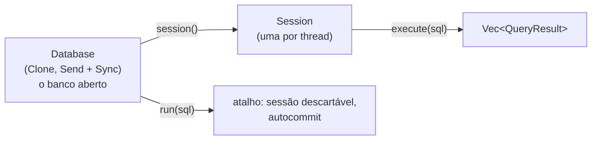

# Guia: usando o rustysql como biblioteca Rust

O rustysql é um banco **embutido**: você o liga ao seu programa e fala com ele por chamadas de
função, sem servidor nem rede. A referência completa da API é o rustdoc (`cargo doc --no-deps --open`);
este guia mostra os padrões de uso.

## Adicionando ao projeto

```toml
# Cargo.toml
[dependencies]
rustysql = { git = "https://github.com/snake-outerheaven/rustysql" }
```

## O modelo em 30 segundos



| Tipo | Papel | Compartilhável entre threads? |
|---|---|---|
| `Database` | o banco aberto | **sim**: `Clone` barato, passe um clone por thread |
| `Session` | uma "conexão", com transação e prioridade próprias | **não ao mesmo tempo**: uma por thread (pode ser *movida*) |
| `QueryResult` | resultado de **um** comando | dados puros |

## Abrir e executar

```rust
use rustysql::{Database, QueryResult, Value};

fn main() -> rustysql::Result<()> {
    let db = Database::open("loja.db")?;            // cria se não existir (+ loja.db.wal)

    db.run("CREATE TABLE clientes (id INT PRIMARY KEY, nome TEXT)")?;
    db.run("INSERT INTO clientes VALUES (1, 'Ana'), (2, 'Beto')")?;

    for resultado in db.run("SELECT id, nome FROM clientes ORDER BY id")? {
        if let QueryResult::Rows { columns, rows } = resultado {
            println!("{columns:?}");
            for linha in rows {
                println!("{linha:?}");               // [Int(1), Text("Ana")]
            }
        }
    }
    Ok(())
}
```

> O banco **não** tem `CREATE TABLE IF NOT EXISTS`. Para "criar se não existe", teste antes com
> `db.table_names().contains(&"clientes".to_string())`.

## Lendo resultados

`run`/`execute` devolvem **um `QueryResult` por comando** (use `;` para vários):

| Variante | Vem de | Conteúdo |
|---|---|---|
| `Rows { columns, rows }` | `SELECT` | nomes das colunas e linhas (`Vec<Value>`) |
| `Affected(n)` | `INSERT`, `UPDATE`, `DELETE` | linhas afetadas |
| `Done(texto)` | DDL, `BEGIN`..., `EXPLAIN` | uma mensagem (o plano, no `EXPLAIN`) |

`Value` é `Null`, `Int(i64)`, `Float(f64)`, `Text(String)` ou `Bool(bool)`. Um *helper* para extrair uma
coluna inteira:

```rust
fn primeira_coluna_int(resultados: Vec<QueryResult>) -> Vec<i64> {
    match resultados.into_iter().next() {
        Some(QueryResult::Rows { rows, .. }) => rows
            .into_iter()
            .filter_map(|mut linha| match linha.remove(0) { Value::Int(i) => Some(i), _ => None })
            .collect(),
        _ => vec![],
    }
}
```

## Parâmetros e injeção de SQL

**Não existem *prepared statements***: o SQL é um texto. Ao incluir valores do usuário, **escape as aspas**
(`'` → `''`) ou valide o tipo, senão o seu programa é vulnerável a injeção de SQL:

```rust
fn literal(texto: &str) -> String {
    format!("'{}'", texto.replace('\'', "''"))
}

let nome = "D'Ávila";
db.run(&format!("INSERT INTO clientes VALUES (3, {})", literal(nome)))?;
```

Números: formate-os você mesmo a partir de `i64`/`f64` (nunca de texto do usuário).

## Transações

Use uma `Session` e `BEGIN`/`COMMIT`/`ROLLBACK`:

```rust
let mut s = db.session();
s.execute("BEGIN")?;
s.execute("UPDATE conta SET saldo = saldo - 100 WHERE id = 1")?;
s.execute("UPDATE conta SET saldo = saldo + 100 WHERE id = 2")?;
s.execute("COMMIT")?;
```

* Se a `Session` for descartada com uma transação aberta, ela sofre **rollback**.
* Um comando que falha desfaz **só ele**; a transação continua (veja o
  [guia de transações](concurrency-and-transactions.md)).
* Idiomático em Rust: um *helper* que garante `COMMIT` ou `ROLLBACK`:

```rust
use rustysql::{Result, Session};

fn em_transacao<T>(s: &mut Session, f: impl FnOnce(&mut Session) -> Result<T>) -> Result<T> {
    s.execute("BEGIN")?;
    match f(s) {
        Ok(v) => { s.execute("COMMIT")?; Ok(v) }
        Err(e) => {
            // Deadlock/LockTimeout já desfazem a transação sozinhos; ignore o erro do ROLLBACK
            let _ = s.execute("ROLLBACK");
            Err(e)
        }
    }
}
```

## Várias threads

```rust
use std::thread;

let db = Database::open("loja.db")?;
let trabalhadores: Vec<_> = (0..4).map(|t| {
    let db = db.clone();                       // barato: só incrementa um Arc
    thread::spawn(move || -> rustysql::Result<()> {
        let mut s = db.session();              // uma sessão por thread
        s.execute(&format!("INSERT INTO log VALUES ({t}, 'olá')"))?;
        Ok(())
    })
}).collect();
for t in trabalhadores { t.join().unwrap()?; }
```

Detalhes (locks, deadlocks, repetição de transações, prioridades) em
[`concurrency-and-transactions.md`](concurrency-and-transactions.md).

## Tratando erros

```rust
use rustysql::Error;

match s.execute("INSERT INTO clientes VALUES (1, 'x')") {
    Ok(_) => {}
    Err(Error::Exec(msg)) if msg.contains("chave primária duplicada") => { /* trate */ }
    Err(Error::Deadlock | Error::LockTimeout) => { /* repita a transação */ }
    Err(e) => return Err(e),
}
```

Os erros **transitórios** (`Deadlock`, `LockTimeout`, `QueueTimeout`) são os que vale a pena repetir. As
mensagens de `Exec` são texto livre (não há códigos estáveis): compare por trecho com cautela. Catálogo
completo: [`../reference/errors.md`](../reference/errors.md).

## Configuração

```rust
use rustysql::{Database, Options};

let db = Database::open_with("loja.db", Options { pool_pages: 16_384, ..Options::default() })?;
```

Veja [`../reference/configuration.md`](../reference/configuration.md) para cada opção.

## Prioridades

```rust
let mut relatorio = db.session();
relatorio.set_priority(rustysql::Priority::Low);      // não atrapalha o tráfego normal
let mut painel = db.session();
painel.execute("SET PRIORITY HIGH")?;                  // equivalente em SQL
```

## Diagnóstico a partir do código

| Chamada | Devolve |
|---|---|
| `db.table_names()` | nomes das tabelas |
| `db.describe("t")` | colunas e índices |
| `db.scheduler_stats()` | fila de admissão |
| `db.lock_snapshot()` | quem segura/espera locks |
| `db.dirty_pages()`, `db.wal_bytes()` | estado do pool e do log |

## Encerrando

Quando o **último** `Database` (e a última `Session`) é descartado, o banco faz um **checkpoint** e deixa o
`.wal` vazio. Se o processo morrer antes disso, **nada se perde**: na próxima abertura o banco refaz o log
(veja o [runbook](operations-runbook.md)).

## Testando o seu código

Abra o banco num arquivo temporário e desligue o `fsync` para ir rápido:

```rust
let caminho = std::env::temp_dir().join(format!("teste_{}.db", std::process::id()));
let db = Database::open_with(&caminho, Options { sync_commits: false, ..Options::default() })?;
```
