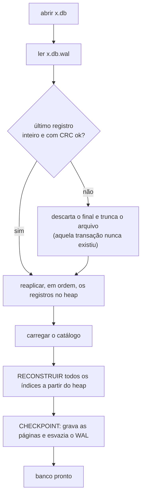
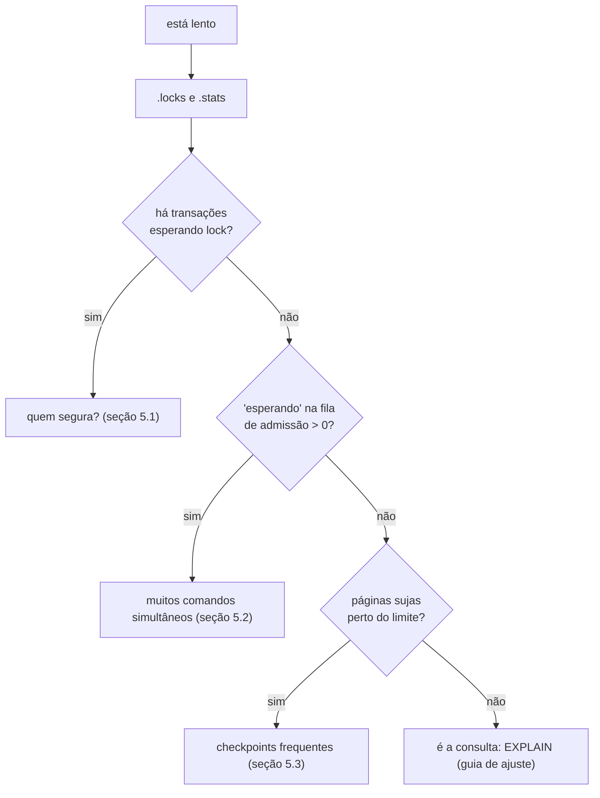

# Runbook de operação

Procedimentos para quem **opera** um banco rustysql: arquivos, backup, o que acontece numa queda,
diagnóstico de lentidão e de erros. Escrito como lista de verificação: cada seção responde "o que eu
faço quando...".

> O rustysql é um projeto de **estudo**. Nada aqui o torna adequado para dados que importam; mas os
> procedimentos refletem o comportamento real do código.

## 1. Inventário: o que existe em disco

| Arquivo | Para que serve | Pode apagar? |
|---|---|---|
| `x.db` | o banco (páginas de 4 KB) | **não** |
| `x.db.wal` | log de commits desde o último checkpoint | **não**, se o banco não foi fechado limpamente |

* Um banco **fechado limpamente** tem `x.db.wal` com **0 bytes**.
* Os dois arquivos formam **um** banco: copie/mova sempre os dois, juntos.
* Formatos: [`../reference/storage-formats.md`](../reference/storage-formats.md).

## 2. Backup

O arquivo `.db` só muda em **checkpoints**; o `.wal` só cresce nos commits.

### Backup consistente (recomendado)

1. Pare as escritas (ou garanta que nenhuma transação está aberta).
2. Rode `CHECKPOINT;` (fora de uma transação). Depois dele, `.wal` tem 0 bytes e `.db` contém tudo.
3. Copie `x.db` **e** `x.db.wal`.
4. Libere as escritas.

Verifique: `.stats` deve mostrar `páginas sujas: 0   WAL: 0 bytes` logo após o `CHECKPOINT`.

### O que **não** fazer

* Copiar só o `.db` de um banco **em uso**: commits recentes estão só no `.wal`.
* Copiar o `.db` **durante** um checkpoint: as páginas podem estar parcialmente gravadas.
* Fazer backup com o processo escrevendo, sem parar: use o procedimento acima.

### Restaurar

Coloque os dois arquivos no lugar e abra o banco. Se o backup foi feito logo após um `CHECKPOINT`, o `.wal`
é vazio e a abertura é instantânea.

## 3. Queda do processo (crash, `kill -9`, falta de energia)

**O banco se recupera sozinho na próxima abertura.** Não há nada a fazer além de abri-lo.

### O que a recuperação faz



### Garantias

| Situação no momento da queda | Resultado |
|---|---|
| transação **já commitada** (`COMMIT` retornou `Ok`) | **preservada** (com `sync_commits = true`) |
| transação **aberta** (sem `COMMIT`) | **descartada** por inteiro |
| `COMMIT` **em andamento** (WAL escrito pela metade) | descartada: a CRC acusa o registro incompleto |
| queda **durante o checkpoint** | o WAL ainda existe e é reaplicado (as operações são idempotentes) |
| queda **durante a recuperação** | basta abrir de novo: o mesmo processo se repete |

Com `sync_commits = false`, uma queda do **sistema** (não só do processo) pode perder commits recentes
(estavam no cache do SO).

### Sintomas e tempo

* A primeira abertura depois da queda é **mais lenta**: o tempo é proporcional ao **tamanho dos dados
  com índice** (os índices são reconstruídos lendo as tabelas) mais o tamanho do WAL.
* Depois dela, o `.wal` fica com 0 bytes.

## 4. Mensagens de erro na abertura

| Mensagem | Significado | O que fazer |
|---|---|---|
| `arquivo não é um banco rustysql (ou está em formato antigo; apague-o)` | o arquivo não começa com o *magic* `RUSTYSQ2` | confira o caminho; se é de uma versão anterior, **não há migração** (recrie) |
| `chave duplicada ao reconstruir 'idx'` | a reconstrução de um índice **único** achou valores repetidos nos dados | os dados estão inconsistentes; restaure um backup |
| `linha de catálogo inválida` / `esquema corrompido no catálogo` | o catálogo (página 1) está ilegível | restaure um backup |
| `storage error: ...` (outras) | arquivo corrompido ou defeito | restaure um backup; guarde o arquivo para análise |
| `io error: ...` | SO: permissão, disco cheio, arquivo em uso | veja a mensagem do SO |

> Um **WAL corrompido no meio** (não no final) faz a recuperação **parar** no registro ruim e descartar o
> resto: perde os commits posteriores. Isso só afeta commits **desde o último checkpoint**.

Catálogo completo: [`../reference/errors.md`](../reference/errors.md).

## 5. Diagnóstico de lentidão

Comece **sempre** por saber se o tempo é de **execução** ou de **espera**.



### 5.1 Locks

`.locks` (ou `db.lock_snapshot()`):

```
tabela 2: txn7:Exclusive
txn8 espera por [7]
txn9 espera por [7, 8]
```

Leitura: a transação 7 segura a tabela 2 em modo exclusivo; as 8 e 9 esperam. Procure a **sessão da transação
7**: costuma ser uma transação **esquecida aberta** (um `BEGIN` sem `COMMIT`; o prompt do REPL fica
`rustysql*>`). Feche-a (`COMMIT` ou `ROLLBACK`) ou encerre a sessão (o *drop* faz rollback).

| Sintoma | Causa provável | Ação |
|---|---|---|
| `LockTimeout` frequente | uma transação longa ou esquecida segurando locks | encurte transações; `lock_timeout` maior só esconde o problema |
| `Deadlock` frequente | ordens diferentes de tabelas entre transações | padronize a ordem; veja o [guia](concurrency-and-transactions.md#deadlocks) |
| leitores esperando um escritor longo | um `UPDATE` sem índice sobre tabela grande | indexe a coluna do `WHERE` |

### 5.2 Fila de admissão

`.stats`:

```
fila: 64 rodando, 12 esperando | admitidos low/normal/high: 120/9300/410 | em transação: 2201 | retomados: 38 | maior espera: 4.30s
```

`rodando` no limite (`max_running`) e `esperando` > 0 significa que há mais comandos simultâneos do que
vagas. Opções: aumentar `SchedConfig::max_running`; **rebaixar** cargas de fundo com
`SET PRIORITY LOW`; ou reduzir a concorrência no cliente. `QueueTimeout` indica espera acima de
`queue_timeout`.

### 5.3 Checkpoints

`.stats` mostra `páginas sujas`. Quando passa de `checkpoint_ratio × pool_pages` o próximo `begin` faz um
checkpoint, que **bloqueia** as transações por um instante e **espera** as ativas terminarem. Se isso
aparece como pausas periódicas:

* aumente `pool_pages` (mais páginas antes de precisar de um checkpoint);
* **diminua transações longas** (o checkpoint as espera);
* para cargas em lote, rode `CHECKPOINT;` entre lotes.

> **Atenção**: uma transação explícita **ociosa** (aberta e parada) **bloqueia o checkpoint
> indefinidamente**, e como checkpoints pendentes seguram novas transações, o banco inteiro "congela".
> Procure-a em `.locks`.

### 5.4 Cache (buffer pool)

Muitas leituras de disco repetidas → `pool_pages` pequeno para o conjunto de trabalho. O erro
`buffer pool cheio de páginas sujas/fixadas` é o **limite de tamanho de uma transação**: divida a
transação em lotes menores ou aumente o pool.

## 6. Manutenção

| Tarefa | Como |
|---|---|
| gravar tudo e esvaziar o WAL agora | `CHECKPOINT;` |
| fechar limpamente | `.exit` no REPL, ou descartar o último `Database`/`Session` |
| reclamar espaço | **não há `VACUUM`**: páginas de `DROP TABLE` e de linhas apagadas só são reaproveitadas dentro da própria tabela. Para encolher o arquivo, exporte e recrie o banco |
| conferir a integridade de um índice | não há comando; a **recuperação** reconstrói todos os índices (qualquer queda os conserta) |
| ver o esquema | `.tables`, `.schema <tabela>` |

### Crescimento do arquivo

O `.db` **só cresce**: páginas nunca são devolvidas ao sistema de arquivos. `DELETE` libera espaço
**dentro** das páginas da tabela (reaproveitado por novos `INSERT`s); `DROP TABLE` **não** devolve páginas.
O `.wal` cresce com os commits e volta a 0 no checkpoint.

## 7. Limites a conhecer

| Limite | Valor | Consequência |
|---|---|---|
| tamanho de uma linha | 4084 bytes | `registro de N bytes não cabe numa página` |
| tamanho de uma chave de índice (codificada) | 512 bytes | `chave de índice com N bytes` |
| tamanho de uma transação | ≈ o buffer pool | `buffer pool cheio ...` |
| concorrência de escrita | 1 transação por **tabela** | escritores da mesma tabela se serializam |
| versões do formato | só `RUSTYSQ2` | sem migração |

## 8. Checklist de produção (se, mesmo assim, você for usar)

- [ ] `sync_commits = true`
- [ ] `lock_timeout` compatível com a sua transação mais longa legítima
- [ ] clientes **repetem** transações em `Deadlock`/`LockTimeout`/`QueueTimeout`
- [ ] nenhuma transação aberta esperando interação humana
- [ ] backup periódico com `CHECKPOINT` + cópia dos **dois** arquivos
- [ ] `pool_pages` ≥ 4× o tamanho da maior transação (em páginas)
- [ ] monitorar `.stats` (`maior espera`) e `.locks`

## Veja também

[`../reference/configuration.md`](../reference/configuration.md) ·
[`../reference/errors.md`](../reference/errors.md) ·
[`../architecture/runtime-scenarios.md`](../architecture/runtime-scenarios.md#4-abertura-do-banco-e-recuperação) ·
[ADR-0002](../adr/0002-no-steal-no-force-wal-redo.md)
