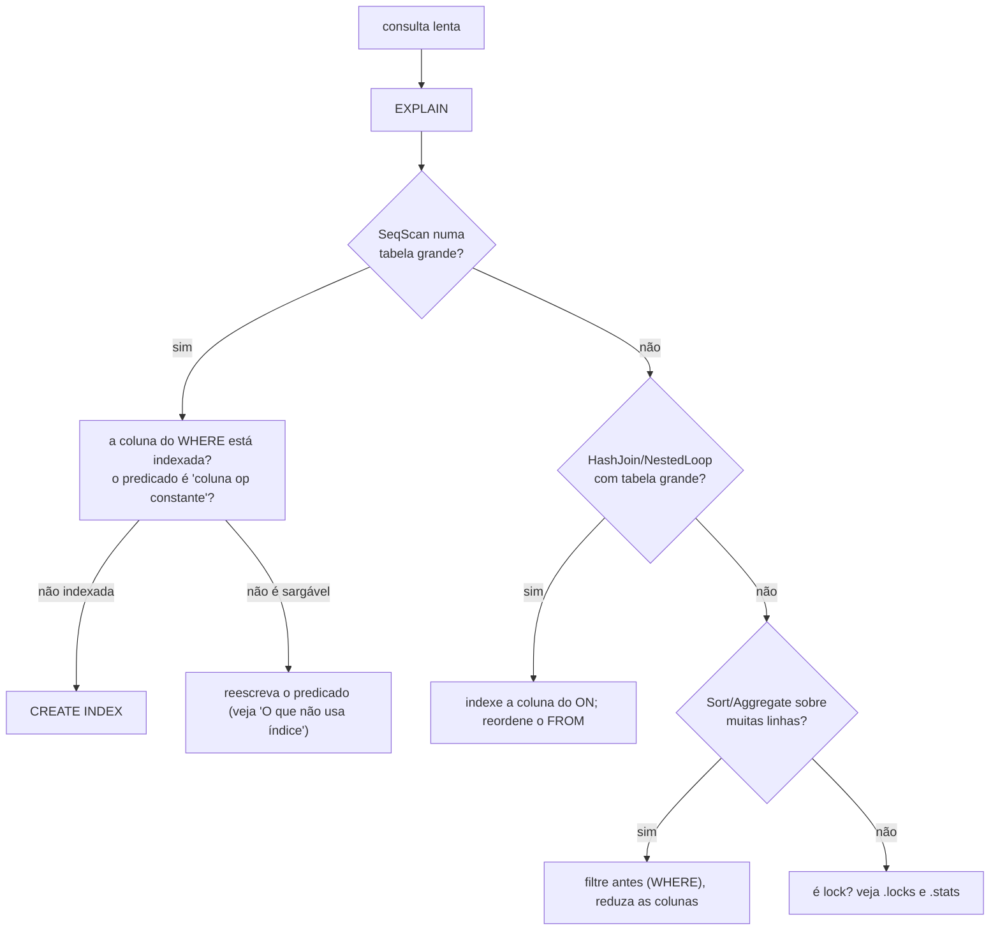

# Guia: entendendo e acelerando consultas (`EXPLAIN`)

Como ler o plano que o banco escolhe e o que fazer quando uma consulta está lenta. **Todos os planos
abaixo são saídas reais** (tabela `pessoas` com 2000 linhas e `depts` com 7).

```sql
CREATE TABLE pessoas (id INT PRIMARY KEY, nome TEXT, idade INT, dept_id INT);
CREATE TABLE depts   (id INT PRIMARY KEY, nome TEXT);
```

## Lendo um plano

`EXPLAIN` mostra a **árvore de operadores** sem executar a consulta. Cada linha é um operador; os
**filhos** (indentados) alimentam o pai. A execução começa nas **folhas** (embaixo) e sobe.

```
EXPLAIN SELECT nome FROM pessoas WHERE idade = 30;

Project [nome]                       ← 3º: calcula as colunas pedidas
  Filter (idade = 30)                ← 2º: descarta o que não casa
    SeqScan pessoas                  ← 1º: lê a tabela inteira
```

### Os operadores

| Operador | O que faz | Custo típico |
|---|---|---|
| `SeqScan t` | lê **todas** as linhas da tabela | proporcional ao tamanho da tabela |
| `IndexScan t using idx (cond)` | percorre **só o trecho** do índice que satisfaz `cond` e busca cada linha | proporcional ao nº de linhas **encontradas** |
| `Filter p` | descarta linhas em que `p` não é `TRUE` | uma avaliação por linha |
| `Project [...]` | calcula as colunas de saída | uma avaliação por linha |
| `Sort [...]` | ordena (**materializa** tudo na memória) | n log n |
| `Aggregate group by [...] compute [...]` | agrupa por hash (materializa) | uma passada |
| `Limit n offset k` | corta | trivial |
| `IndexNestedLoopJoin ... probe t using idx` | para cada linha da esquerda, **busca no índice** da direita | uma busca por linha da esquerda |
| `HashJoin on a = b` | monta uma tabela hash com um lado e sonda com o outro | linear nos dois lados |
| `NestedLoopJoin` | compara **todos** com **todos** | produto dos tamanhos |

> O `Filter` aparece **mesmo quando há `IndexScan`**: o planejador sempre reaplica o predicado inteiro por
> cima do índice. O índice só *estreita* o conjunto; o filtro garante o resultado.

## Quando o índice é usado

O planejador procura, no `WHERE`, condições `coluna <op> constante` (o literal pode estar de qualquer lado)
sobre colunas **indexadas**, com `<op>` em `=`, `<`, `<=`, `>`, `>=` (e `BETWEEN`, que vira `>=` e `<=`).

```
EXPLAIN SELECT * FROM pessoas WHERE id = 1500;
  Filter (id = 1500)
    IndexScan pessoas using pk_pessoas (id = 1500)

EXPLAIN SELECT * FROM pessoas WHERE id = 2 + 3;          -- constante calculada: serve
    IndexScan pessoas using pk_pessoas (id = 5)

EXPLAIN SELECT * FROM pessoas WHERE id > 100 AND id < 200 AND idade = 3;
  Filter (((id > 100) AND (id < 200)) AND (idade = 3))
    IndexScan pessoas using pk_pessoas (id > 100 AND id < 200)   -- o resto vira filtro
```

**Pontuação** quando há mais de um índice candidato:

| Situação | Pontos |
|---|---:|
| igualdade num índice **único** (ex.: chave primária) | 100 |
| igualdade num índice comum | 80 |
| intervalo com os **dois** limites (`>=` e `<=`) | 60 |
| intervalo de **um** lado | 40 |

Com `WHERE dept_id = 3 AND idade > 50` e índices em ambas as colunas, ganha o de `dept_id` (igualdade, 80 pontos
contra 40) e o `idade > 50` fica como filtro.

### O que **não** usa índice

| Escrito | Por quê | Alternativa |
|---|---|---|
| `WHERE id + 1 = 5` | a coluna está **dentro de uma expressão** | `WHERE id = 4` |
| `WHERE id = 5 OR id = 6` | `OR` não vira intervalo | duas consultas, ou `BETWEEN` se forem contíguos |
| `WHERE id IN (1, 2, 3)` | vira `OR` | idem |
| `WHERE nome LIKE 'pessoa1%'` | `LIKE` nunca usa índice | com um índice em `nome`, reescreva como intervalo: `nome >= 'pessoa1' AND nome < 'pessoa2'` |
| `WHERE id = 1.5` (coluna `INT`) | o literal não converte para o tipo da coluna | use um inteiro |
| `WHERE idade <> 30` | desigualdade não é um intervalo | |
| coluna **sem índice** | | `CREATE INDEX` |

```
EXPLAIN SELECT * FROM pessoas WHERE id + 1 = 5;
  Filter ((id + 1) = 5)
    SeqScan pessoas
```

> **Atenção**: com duas restrições do **mesmo lado** da mesma coluna (`id < 10 AND id < 5`), só a
> **primeira** estreita o índice (`id < 10`); a outra é só filtro. O resultado é correto, só menos
> eficiente. Escreva a restrição mais forte primeiro.

## Receita 1: filtrar por uma coluna sem índice

```
EXPLAIN SELECT nome FROM pessoas WHERE idade = 30;            -- antes
  Filter (idade = 30)
    SeqScan pessoas

CREATE INDEX idx_idade ON pessoas(idade);

EXPLAIN SELECT nome FROM pessoas WHERE idade = 30;            -- depois
  Filter (idade = 30)
    IndexScan pessoas using idx_idade (idade = 30)
```

Medida numa tabela de 20 mil linhas (`cargo run --release -- demo.db demo.sql`, o script traz esse caso):

| Consulta | Sem índice | Com índice |
|---|---:|---:|
| `WHERE nome = 'pessoa19999'` | 5,9 ms | **52 µs** |
| `WHERE id = 19999` (chave primária) | n/a | 175 µs |

## Receita 2: junções

O algoritmo é escolhido por esta ordem: **índice** na coluna da direita → **hash** → **laço aninhado**.

```
-- sem índice em pessoas.dept_id: o banco monta uma tabela hash
EXPLAIN SELECT p.nome FROM depts d JOIN pessoas p ON p.dept_id = d.id WHERE d.nome = 'eng';
  HashJoin Inner on d.id = p.dept_id
    Filter (d.nome = 'eng')
      SeqScan depts AS d
    SeqScan pessoas AS p

CREATE INDEX idx_dept ON pessoas(dept_id);

-- com índice: para cada linha de depts que sobrou, uma busca no índice
EXPLAIN SELECT p.nome FROM depts d JOIN pessoas p ON p.dept_id = d.id WHERE d.nome = 'eng';
  IndexNestedLoopJoin Inner probe pessoas AS p using idx_dept with d.id
    Filter (d.nome = 'eng')
      SeqScan depts AS d
```

Regras práticas:

* **Indexe a coluna da junção** do lado "grande" (aqui `pessoas.dept_id`).
* A **ordem do `FROM` é a ordem da junção** (o planejador não reordena): comece pela tabela que o
  `WHERE` mais **reduz** (aqui `depts`, filtrada para 1 linha, e depois `pessoas` por índice).
* O filtro de **uma só** tabela é empurrado para baixo, até o scan dela (`Filter (d.nome = 'eng')` está
  *dentro* da junção). Isso já reduz o trabalho antes de juntar.
* `NestedLoopJoin` aparece quando o `ON` **não tem igualdade** (`a.x < b.y`): evite em tabelas grandes.

### `LEFT JOIN` e `WHERE`

Um filtro sobre a tabela da **direita** de um `LEFT JOIN` roda **depois** da junção (empurrá-lo para
baixo mudaria o resultado) e, por isso, descarta as linhas sem par:

```
EXPLAIN SELECT p.nome FROM pessoas p LEFT JOIN depts d ON p.dept_id = d.id WHERE d.nome = 'eng';
  Filter (d.nome = 'eng')                                  ← acima da junção
    IndexNestedLoopJoin Left probe depts AS d using pk_depts with p.dept_id
      SeqScan pessoas AS p
```

Se a intenção é "pessoas **com ou sem** departamento, mas só do `eng`", ponha a condição no `ON`:
`LEFT JOIN depts d ON p.dept_id = d.id AND d.nome = 'eng'`.

## Receita 3: agregações

```
EXPLAIN SELECT dept_id, COUNT(*) AS n, AVG(idade) FROM pessoas
        GROUP BY dept_id HAVING COUNT(*) > 100 ORDER BY n DESC LIMIT 3;

Limit Some(3) offset 0
  Project [dept_id, #agg0, #agg1]
    Sort [#agg0 DESC]
      Filter (#agg0 > 100)                        ← o HAVING, depois de agrupar
        Aggregate group by [dept_id] compute [count(*), avg(idade)]
          SeqScan pessoas
```

* `#agg0`, `#agg1` são as **colunas sintéticas** das agregações (o resto da consulta as referencia).
* **Filtre antes de agregar**: o que pode ir no `WHERE` deve ir no `WHERE` (reduz as linhas que
  entram na agregação). Use `HAVING` só para condições **sobre o resultado** da agregação.
* `Sort` e `Aggregate` **materializam** na memória; para tabelas enormes, filtre antes.

## Receita 4: `ORDER BY ... LIMIT`

```
EXPLAIN SELECT nome FROM pessoas ORDER BY idade LIMIT 3;
Limit Some(3) offset 0
  Project [nome]
    Sort [idade]
      SeqScan pessoas
```

O `Sort` ordena **todas** as linhas antes do `LIMIT` (o banco não aproveita a ordem de um índice nem faz
*top-N*). Em tabelas grandes, restrinja com `WHERE` primeiro.

(`Limit Some(3) offset 0` é só a forma como o plano imprime `LIMIT 3`.)

## Receita 5: `UPDATE` e `DELETE`

Usam o mesmo planejamento de acesso. **Sempre por chave** quando puder:

```
EXPLAIN UPDATE pessoas SET idade = 1 WHERE id = 5;
Update pessoas
  Filter (id = 5)
    IndexScan pessoas using pk_pessoas (id = 5)
```

Sem índice, o `UPDATE`/`DELETE` lê a tabela inteira **com o lock exclusivo segurado**, bloqueando todos os
leitores. Indexe a coluna do `WHERE` de comandos frequentes.

## Receita 6: escrita em lote

| Faça | Evite |
|---|---|
| **um** `INSERT` com várias linhas: `INSERT INTO t VALUES (...), (...), ...` | um `INSERT` por linha (cada um é uma transação com `fsync`) |
| agrupar escritas num `BEGIN ... COMMIT` | `COMMIT` a cada linha |
| `sync_commits: false` numa importação **descartável** | deixar `fsync` ligado para carga em massa |

Medido: **20 mil linhas em um só `INSERT` = 477 ms** (um único commit, um único `fsync`). Em comandos
separados, cada linha paga o seu próprio `fsync` (alguns milissegundos num disco comum). Mas lembre: a
transação precisa **caber no buffer pool**
([configuração](../reference/configuration.md#pool_pages-o-limite-de-tamanho-das-transações)).

## Índices não são de graça

Cada índice **custa a cada `INSERT`, `UPDATE` e `DELETE`** (uma inserção a mais na árvore) e ocupa espaço.
Crie índices para as colunas que aparecem em `WHERE` e `ON` das consultas **frequentes**; não indexe tudo.
Um índice **único** também serve de restrição de integridade.

## Roteiro de diagnóstico



Se o plano está bom e ainda é lento, o problema costuma ser **espera**, não execução: veja `.locks` e
`.stats` ([concorrência](concurrency-and-transactions.md#observando-a-concorrência)).

## Veja também

[`../reference/sql.md`](../reference/sql.md) · [`../modules/plan.md`](../modules/plan.md) ·
[ADR-0015](../adr/0015-planejador-por-regras-e-executor-volcano.md)
