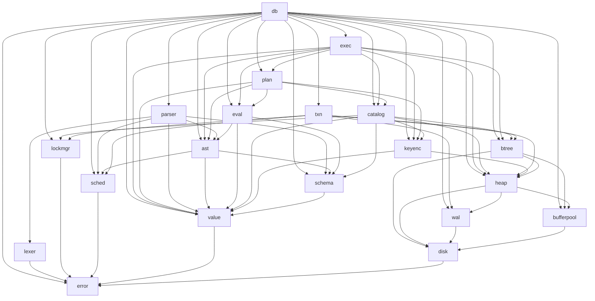

# Referência de módulos

Um documento por módulo do código-fonte (`src/*.rs`). Todos seguem o mesmo modelo, então dá para
comparar e navegar sem reaprender a estrutura.

## Modelo de documento de módulo

| Seção | Conteúdo |
|---|---|
| Ficha | arquivo, camada, dependências (extraídas dos `use`), quem usa, testes |
| 1. Responsabilidade | o que o módulo faz e, igualmente importante, o que **não** faz |
| 2. API pública | tabela de itens exportados |
| 3. Estruturas de dados | tipos, campos e formatos binários |
| 4. Algoritmos e fluxos | como as operações funcionam |
| 5. Invariantes | o que sempre vale (o que os testes e `debug_assert!` protegem) |
| 6. Concorrência | quais locks/latches, em que ordem |
| 7. Erros | o que pode falhar e como |
| 8. Testes | quais testes cobrem o módulo |
| 9. Limitações e evolução | dívidas e próximos passos |
| 10. Veja também | ADRs, outros módulos, referência |

## Índice

| Camada | Módulo | Linhas¹ | Resumo |
|---|---|---:|---|
| Transversal | [`error`](error.md) | 69 | tipo de erro único |
| Base | [`disk`](disk.md) | 80 | páginas de 4 KB num arquivo |
| Base | [`bufferpool`](bufferpool.md) | 286 | cache de páginas com latches, pin e *no-steal* |
| Armazenamento | [`wal`](wal.md) | 232 | log de redo com commit atômico e CRC |
| Armazenamento | [`heap`](heap.md) | 328 | registros em *slotted pages* |
| Armazenamento | [`keyenc`](keyenc.md) | 96 | chaves comparáveis por `memcmp` |
| Armazenamento | [`btree`](btree.md) | 558 | B+tree concorrente com latch crabbing |
| Dados | [`value`](value.md) | 171 | tipos, valores e linhas |
| Dados | [`schema`](schema.md) | 67 | colunas e esquema |
| Motor | [`lockmgr`](lockmgr.md) | 239 | locks de tabela, 2PL, deadlock |
| Motor | [`sched`](sched.md) | 306 | admissão por prioridade com aging |
| Motor | [`txn`](txn.md) | 127 | transação, undo, pontos de salvamento |
| Motor | [`catalog`](catalog.md) | 125 | tabelas e índices em memória |
| SQL | [`lexer`](lexer.md) | 130 | texto → tokens |
| SQL | [`ast`](ast.md) | 394 | árvore sintática |
| SQL | [`parser`](parser.md) | 546 | tokens → comandos |
| SQL | [`eval`](eval.md) | 301 | expressões, `NULL`, ligação de colunas |
| SQL | [`plan`](plan.md) | 687 | planejador por regras |
| SQL | [`exec`](exec.md) | 382 | executor de operadores (Volcano) |
| Motor | [`db`](db.md) | 1010 | `Database`, `Session`, recuperação, DDL/DML |
| Interface | [`main`](main.md) | 153 | REPL e modo script |

¹ Linhas do arquivo, **incluindo** os comentários de documentação (~800 linhas de rustdoc e ~260 de
documentação de módulo). Total: 6416 linhas em `src/`, mais `lib.rs` (129).

## Grafo de dependências

Extraído mecanicamente dos `use crate::...` (comentários ignorados). Uma seta `A → B` significa
"`A` usa `B`". Todas as setas apontam "para baixo": **não há ciclos**.

(`error` é usado por quase todos os módulos; as setas para ele foram omitidas, exceto as dos módulos
folha, para não poluir o desenho.)

### Dependências curiosas, e por quê

| Dependência | Motivo |
|---|---|
| `ast → sched` | `Statement::SetPriority(Priority)` carrega a prioridade |
| `keyenc → heap` | a chave de índice não único inclui o `RowId`, que é definido no heap |
| `heap → wal` | `HeapFile` registra `WalOp` num `Vec` entregue pelo chamador (não escreve no log) |
| `catalog → lockmgr` | só pelo tipo `TableId` (o id de tabela é a raiz do heap) |
| `txn → btree`, `txn → heap` | o log de undo guarda handles de árvore e heap para desfazer |

## Como ler o código

Uma ordem que ensina bem, de baixo para cima:

1. [`disk`](disk.md) → [`bufferpool`](bufferpool.md): o que é uma página e quem a cacheia
2. [`heap`](heap.md): onde ficam as linhas
3. [`keyenc`](keyenc.md) → [`btree`](btree.md): como achar uma linha sem varrer tudo
4. [`wal`](wal.md) → [`txn`](txn.md) → [`db`](db.md) (`commit`, `rollback`, `open_with`): como não perder nada
5. [`lockmgr`](lockmgr.md) → [`sched`](sched.md): como várias transações convivem
6. [`lexer`](lexer.md) → [`parser`](parser.md) → [`plan`](plan.md) → [`exec`](exec.md): do texto SQL ao resultado
