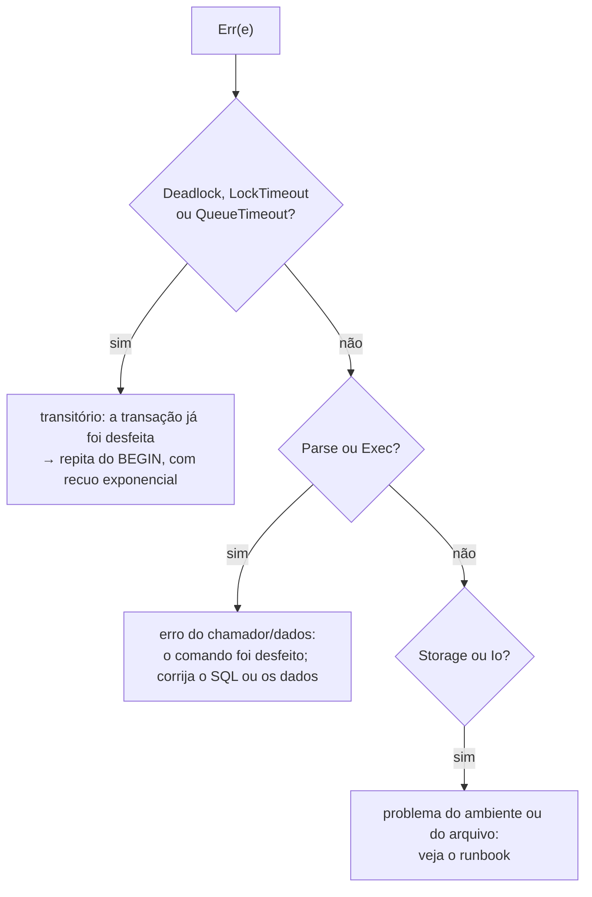

# Catálogo de erros

Todas as operações falíveis devolvem `rustysql::Result<T>` com o tipo único [`Error`](../modules/error.md).
Este documento lista **todas as mensagens** que o código pode produzir (extraídas de `src/`), o que
significam e o que fazer.

## Como tratar um erro

| Variante | Transitória? | O estado depois do erro |
|---|:---:|---|
| `Parse` | não | nada foi executado |
| `Exec` | não | o **comando** foi desfeito; numa transação explícita ela continua aberta |
| `Storage` | não | o comando foi desfeito (se possível); trate como defeito |
| `Io` | não | idem |
| `Deadlock` | **sim** | a transação **inteira** foi desfeita; todos os locks soltos |
| `LockTimeout` | **sim** | idem |
| `QueueTimeout` | **sim** | o comando não chegou a rodar; numa transação explícita ela continua aberta |

Padrão recomendado de *retry*: [`guides/concurrency-and-transactions.md`](../guides/concurrency-and-transactions.md#repetindo-transações).

---

## `Parse`: erros de sintaxe (prefixo `syntax error:`)

| Mensagem | Causa | Correção |
|---|---|---|
| `string sem fechar` | aspa simples sem par | feche com `'`; escreva `''` para uma aspa no texto |
| `número inválido` | decimal que não converte | confira o literal |
| `inteiro fora do intervalo` | literal maior que `i64` | use um valor menor ou `FLOAT` |
| `caractere inesperado 'x'` | caractere que o SQL não usa (`"`, `@`, `#`, `[`...) | remova; identificadores não vão entre aspas |
| `token inesperado X` | algo depois do fim de um comando | falta um `;` entre comandos? |
| `esperava X, encontrei Y` | o texto não segue a gramática | compare com [`sql.md`](sql.md#gramática) |
| `esperava KW, encontrei Y` | falta uma palavra-chave (`FROM`, `INTO`, `ON`...) | idem |
| `esperava identificador, encontrei X` | nome de tabela/coluna ausente | idem |
| `comando desconhecido: X` | primeira palavra não é um comando | veja a lista de comandos |
| `tipo desconhecido 'x'` | tipo de coluna inexistente | use `INT`, `FLOAT`, `TEXT`, `BOOL` ou um alias |
| `tamanho inválido: X` | `VARCHAR(n)` sem inteiro | `VARCHAR(255)` |
| `LIMIT inválido: X` / `OFFSET inválido: X` | valor que não é inteiro ≥ 0 | use um inteiro não negativo |
| `expressão inválida perto de X` | expressão incompleta (`1 +`, `)` solto) | confira parênteses e operandos |
| `função desconhecida 'x'` | só existem `COUNT SUM AVG MIN MAX` | veja [agregações](sql.md#agregações-e-agrupamento) |
| `DISTINCT em agregações não é suportado` | `COUNT(DISTINCT x)` | não suportado |
| `sum(*) não existe` (e similares) | `*` só vale em `COUNT` | use `COUNT(*)` ou uma coluna |
| `UNIQUE só vale para CREATE INDEX` | `CREATE UNIQUE TABLE` | `CREATE UNIQUE INDEX ...` |
| `prioridade desconhecida 'x' (use LOW, NORMAL ou HIGH)` | `SET PRIORITY` inválido | use um dos três |

## `Exec`: erros de execução (prefixo `error:`)

### Tabelas, colunas e índices

| Mensagem | Causa |
|---|---|
| `tabela 'x' não existe` | nome errado, ou a tabela foi removida (inclusive enquanto você esperava o lock) |
| `tabela 'x' já existe` | `CREATE TABLE` repetido |
| `tabela sem colunas` | `CREATE TABLE` vazio |
| `coluna 'x' duplicada` | duas colunas com o mesmo nome no `CREATE TABLE` |
| `só uma PRIMARY KEY é suportada` | duas colunas `PRIMARY KEY` |
| `coluna desconhecida 'x'` / `'t.x'` | a coluna não existe (ou o alias `t` não bate) |
| `coluna 'x' é ambígua; qualifique com o nome da tabela` | o nome existe em mais de uma tabela do `FROM`: use `e.nome` |
| `coluna 'x' repetida` | coluna listada duas vezes no `INSERT (...)` |
| `índice 'x' já existe` / `não existe` | nome de índice (único em **todo** o banco) |
| `o índice da chave primária não pode ser removido` | `DROP INDEX pk_<tabela>` |
| `'t.*' não casa com nenhuma tabela` | `t.*` com `t` fora do `FROM` |
| `alias 'x' repetido; use AS para diferenciar` | a mesma tabela duas vezes sem alias distinto |
| `ON referencia uma tabela que ainda não foi ligada` | o `ON` cita uma tabela de um `JOIN` posterior |

### Valores e restrições

| Mensagem | Causa |
|---|---|
| `esperava N valores, recebi M` | quantidade errada no `INSERT` |
| `coluna 'x' não aceita NULL` | `NULL` em coluna `NOT NULL`/`PRIMARY KEY` |
| `coluna 'x' é INT, mas recebeu Text("a")` | tipo errado (só `INT→FLOAT` é convertido) |
| `chave primária duplicada: 5` | já existe uma linha com essa chave |
| `valor duplicado no índice único 'idx': a` | viola um `UNIQUE INDEX` (o valor aparece sem aspas) |
| `não dá para criar o índice único 'idx': há valores repetidos em 'col'` | `CREATE UNIQUE INDEX` sobre dados repetidos |
| `registro de N bytes não cabe numa página` | linha maior que 4084 bytes (um `TEXT` enorme) |
| `chave de índice com N bytes (máximo 512)` | valor indexado grande demais (ou vazio) |

### Expressões

| Mensagem | Causa |
|---|---|
| `divisão por zero` | `x / 0` ou `x % 0` com inteiros |
| `overflow inteiro` / `overflow em SUM` | resultado fora do `i64` |
| `não é possível comparar X com Y` | comparação entre tipos incompatíveis (`1 = 'a'`) |
| `operador X inválido para Y` / `X inválido entre A e B` | operador sobre tipos que não suporta (`'a' - 1`) |
| `esperava booleano, veio X` | `AND`/`OR`/`NOT` sobre algo que não é booleano |
| `a condição precisa ser booleana, veio X` | `WHERE`/`ON`/`HAVING` que não dá booleano |
| `LIKE exige texto, recebeu A e B` | `LIKE` sobre não-texto |
| `SUM exige número, recebeu X` / `AVG exige número, ...` | agregação sobre não numérico |
| `função de agregação não é permitida neste contexto` / `... em WHERE/ON` | `COUNT(*)` no `WHERE` (use `HAVING`) |

### Transações e administração

| Mensagem | Causa |
|---|---|
| `já existe uma transação aberta` | `BEGIN` dentro de `BEGIN` |
| `não há transação aberta` | `COMMIT`/`ROLLBACK` sem `BEGIN` |
| `CHECKPOINT não pode rodar dentro de uma transação` | feche a transação antes |
| `DDL não é permitido dentro de uma transação explícita` | `CREATE`/`DROP` dentro de `BEGIN` |
| `EXPLAIN só vale para SELECT, UPDATE e DELETE` | `EXPLAIN` de outro comando |

### Erros internos de `Exec` (não deveriam ocorrer)

`comando de transação inesperado`, `plano de acesso inválido`, `MIN exige um argumento`,
`MAX exige um argumento`. Se aparecerem, é um defeito: abra uma *issue* com o SQL.

## `Storage`: armazenamento (prefixo `storage error:`)

| Mensagem | Significado | Ação |
|---|---|---|
| `buffer pool cheio de páginas sujas/fixadas: transação grande demais para o pool` | a transação tocou mais páginas do que cabem no pool (política *no-steal*) | divida em transações menores ou aumente `Options::pool_pages` |
| `arquivo não é um banco rustysql (ou está em formato antigo; apague-o)` | magic inválido | outro arquivo, ou banco de uma versão anterior (não há migração) |
| `página N inexistente` | referência a página fora do arquivo | arquivo corrompido |
| `nó de B-tree corrompido` / `B-tree inválida (página N): ...` / `cadeia de folhas ...` | a estrutura de um índice está inconsistente | reabra o banco com o WAL íntegro (a recuperação reconstrói os índices) |
| `índice aponta para registro inexistente` | um índice referencia uma linha apagada | idem |
| `chave duplicada ao reconstruir 'idx'` | a reconstrução de um índice único achou duplicatas nos dados | dados inconsistentes |
| `linha de catálogo inválida` / `esquema corrompido no catálogo` | catálogo ilegível | arquivo corrompido |
| `registro truncado` / `tag desconhecida N` / `texto UTF-8 inválido` | linha serializada inválida | arquivo corrompido |
| `registro (RowId { ... }) não existe` / `sem espaço para restaurar ...` | falha no *undo* de um delete | defeito |
| `WAL: sem espaço na página N no redo` | falha ao reaplicar o log | WAL ou arquivo corrompido |

## `Io`: sistema operacional (prefixo `io error:`)

Encapsula o `std::io::Error`: permissão, disco cheio, arquivo em uso, falha de `fsync`. Veja a mensagem
do SO que acompanha.

## `Deadlock`, `LockTimeout`, `QueueTimeout`: transitórios

| Mensagem | Quando |
|---|---|
| `deadlock detectado: transação abortada` | esta transação foi escolhida como vítima de um ciclo de espera por locks. A vítima é a de **menor prioridade**, depois a que segura **menos locks exclusivos**, depois a **mais nova** |
| `tempo esgotado esperando lock: transação abortada` | esperou um lock de tabela por mais de `Options::lock_timeout` (5 s por padrão); suspeite de uma transação esquecida aberta (`.locks`) |
| `tempo esgotado na fila de admissão: servidor sobrecarregado` | esperou uma vaga de execução por mais de `SchedConfig::queue_timeout` (30 s); aumente `max_running` ou reduza a carga |

Os dois primeiros desfazem a **transação inteira**; o terceiro só impede o comando de começar.
